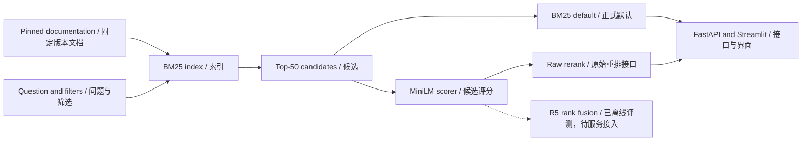

# DevSearch

**English technical-document search with BM25 and a native PyTorch reranker.** A developer can find source-linked passages and code examples; the project also provides reproducible training and ranking experiments.

**基于 BM25 与原生 PyTorch 重排器的英文技术文档检索项目。**开发者可查找带来源的段落和代码示例，并复现实验中的训练与排序评测。

Python · PyTorch · Transformers · MiniLM · FastAPI · Streamlit

**Version `1.0.0` release candidate.** Package and release checks are being completed on `codex/release-v1`; merge/tag/publication are pending the owner's final decision. [Release procedure](docs/RELEASE.md) · [Changelog](CHANGELOG.md).

**版本 `1.0.0` 发布候选。**正在发布分支完成包及交付核验，合并／标签／发布等待所有者最终决定。

## Start here / 从这里开始

| Reader / 读者 | Entry / 入口 |
| --- | --- |
| Understand the project / 了解项目 | [Project guide and file map / 项目导读与目录](docs/PROJECT_GUIDE.md) |
| Run a small example / 运行小样例 | [CPU quick start and reproduction levels / CPU 快速开始与复现范围](docs/REPRODUCIBILITY.md) |
| Review the results / 审阅结果 | [Experiment results / 实验结果](reports/RESULTS.md) · [Evidence index / 证据索引](reports/EVIDENCE_INDEX.md) |
| Understand model and data / 理解模型与数据 | [Model card / 模型说明](docs/MODEL_CARD.md) · [Data card / 数据说明](docs/DATA_CARD.md) |
| Continue development / 接手开发 | [Current handoff / 当前交接](docs/HANDOFF.md) · [Release checklist / 发布清单](docs/TASKS.md) |
| Prepare a demonstration / 准备演示 | [Demo script / 演示脚本](docs/DEMO_SCRIPT.md) · [Code walkthrough / 代码导读](docs/CODE_WALKTHROUGH.md) |

## Verified results / 已核验结果

| Evidence scope / 证据范围 | Outcome / 结果 |
| --- | --- |
| First formal campaign, 197 synthetic test questions / 首轮正式实验，197 个合成测试问题 | Evaluated release retains **BM25**; full fine-tuning did not pass selection. / 已评测版本保留 **BM25** 默认，完整微调未通过选择条件。 |
| R5 + rank fusion, 202 synthetic validation questions, expanded v4 labels / R5 加排名融合，202 个合成验证问题、v4 扩展标签 | Three-seed mean **MRR@10 0.9411**, BM25 **0.9014**. Adaptive validation evidence; no new final-test claim. / 三种子均值 **0.9411**，BM25 **0.9014**；属于反复使用的验证集结果，未新增最终测试声明。 |
| Matched BCE vs pairwise loss, six GPU runs / 匹配 BCE 与排序损失，六次 GPU 训练 | All complete; pairwise direction stopped under its continuation rule. / 均已完成，排序损失方向未达到继续条件。 |
| Real corpus CPU API/UI demo / 真实语料 CPU 接口／界面演示 | Evaluated BM25 release verified through API and rendered UI for search, source links, empty results, invalid filters and fallback. / 已评测 BM25 发布包经接口与真实界面核验检索、来源、空结果、非法筛选及降级。 |

Training and evaluation are complete for the original engineering scope. **The real-corpus BM25 UI demonstration is verified; final merge/publication and deferred large-artifact handoff remain. Live R5 + rank-fusion serving is an optional extension.** The [results report](reports/RESULTS.md) keeps test, validation, latency and diagnostic results separate.

原定工程范围内的训练与评测已完成。**真实语料 BM25 界面演示已核验；最终合并／发布及暂缓的大文件交接仍待完成。R5 加排名融合服务为可选扩展。**[结果报告](reports/RESULTS.md)分别注明测试、验证、延迟与诊断结果的适用范围。

## System / 系统

The application returns passages and source links. It does not generate answers. Data ownership, model identities, recovery and fallback are explicit in the code and [contracts](docs/PROJECT_GUIDE.md#contracts-and-history--契约与历史).

应用返回段落与来源链接，不生成答案。数据归属、模型标识、恢复与降级均有明确实现与[契约](docs/PROJECT_GUIDE.md#contracts-and-history--契约与历史)。

## Repository and artifacts / 仓库与产物

`src/`, `tests/`, `configs/`, `locks/` and `scripts/` contain the implementation. `docs/` explains operation and design; `reports/` contains scoped results and compact evidence. Runtime corpora, review records, model weights and checkpoints are stored outside Git. See [the file map](docs/PROJECT_GUIDE.md) and [private-artifact requirements](docs/REPRODUCIBILITY.md#full-experiment-reproduction--完整实验复现).

`src/`、`tests/`、`configs/`、`locks/`、`scripts/`保存实现；`docs/`解释操作与设计，`reports/`保存注明范围的结果及小型证据。语料、审查记录、模型权重和断点保存在 Git 外。详见[目录说明](docs/PROJECT_GUIDE.md)及[私有产物要求](docs/REPRODUCIBILITY.md#full-experiment-reproduction--完整实验复现)。

This private repository is being organized on `codex/claude-docs` ([PR #4](https://github.com/Hector-sau/devsearch/pull/4)), which includes the verified implementation base `cc0e7f0`. The dependency order is **PR #2 → PR #3 → PR #4**; they are not yet merged into `main`. Historical training receipts retain their original commits. No new release tag is implied by this documentation update.

本私有仓库在 `codex/claude-docs`（[PR #4](https://github.com/Hector-sau/devsearch/pull/4)）整理，已包含验证过的实现基线 `cc0e7f0`。依赖顺序为 **PR #2 → PR #3 → PR #4**，尚未合入 `main`。历史训练回执保留原提交号；本次文档整理不代表新增发布标签。

The [real BM25 demonstration](reports/evidence/release-demo-20261009/README.md) includes actual browser screenshots. Upstream excerpts follow [third-party notices](THIRD_PARTY_NOTICES.md).

[真实 BM25 演示](reports/evidence/release-demo-20261009/README.md)包含实际浏览器截图，上游摘录遵循[第三方说明](THIRD_PARTY_NOTICES.md)。
