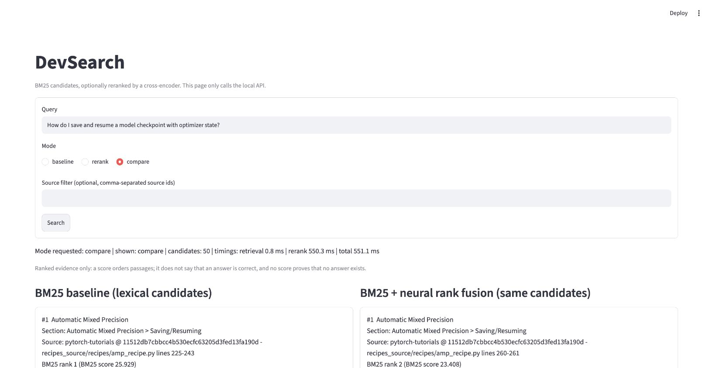

# DevSearch

**English technical-document search with BM25, a native PyTorch MiniLM reranker and source-linked results.** The application helps developers find relevant tutorial passages and code examples. The repository includes training, evaluation, model export, an API and a browser interface.

**基于 BM25、原生 PyTorch MiniLM 重排和来源链接的英文技术文档检索项目。**应用帮助开发者查找相关教程段落与代码示例；仓库包含训练、评测、模型导出、接口和浏览器界面。

Python · PyTorch · Transformers · MiniLM · FastAPI · Streamlit

**Version `1.1.0`.** Exact source, checks and downloadable packages are recorded in the [versioned release](https://github.com/Hector-sau/devsearch/releases/tag/v1.1.0). Original DevSearch code uses [Apache-2.0](LICENSE); upstream material retains the terms in [THIRD_PARTY_NOTICES](THIRD_PARTY_NOTICES.md). [Release procedure](docs/RELEASE.md) · [Changelog](CHANGELOG.md).

**版本 `1.1.0`。**准确源码、检查与下载包见[版本发布](https://github.com/Hector-sau/devsearch/releases/tag/v1.1.0)。DevSearch 原创代码采用 [Apache-2.0](LICENSE)；上游材料继续遵循[第三方说明](THIRD_PARTY_NOTICES.md)中的条款。

**Current local demo integration: `1.1.1.dev0`.** The owner-authorized demo uses the fixed **966-update, seed 42** MiniLM endpoint with BM25 top-50 and reciprocal rank fusion (`alpha=0.5`, `rank_constant=60`). BM25 remains available as a baseline and failure fallback. [CPU demo operation and acceptance](docs/DEMO966_CPU.md) describes activation separately from the published `v1.1.0` release and historical experiment decisions.

**当前本地演示接入：`1.1.1.dev0`。**所有者已授权演示使用固定的 **966 次更新、种子 42** MiniLM 模型，结合 BM25 前 50 和倒数排名融合；BM25 继续作为对照与故障降级方案。[CPU 演示操作与验收](docs/DEMO966_CPU.md)将本次激活与已发布的 `v1.1.0` 及历史实验决策分别记录。

This newer endpoint was trained with **one seed only**. Its matched CPU development comparison covers 47 new synthetic questions and an expanded 81-question set; the original 202-question benchmark is retained separately. Query-bootstrap intervals measure uncertainty across questions, not across training seeds. The three-seed R5 finding below belongs to the original model and must not be attributed to the 966-update endpoint. [All seven systems and interpretation](reports/demo966-development-2026-10-12.md).

这个新模型只训练了**一个种子**。匹配条件的 CPU 开发对比包含 47 个新合成问题及扩充后的 81 题；原 202 题基准单独保留。问题重采样区间衡量问题间的不确定性，不衡量训练种子差异。下文 R5 三种子结果属于原模型，不能归给 966 次更新的新模型。

## Main result / 主要结果

**On the same sealed 202-question validation benchmark, all three R5 training seeds reproduce an MRR@10 improvement over BM25.** R5 plus reciprocal rank fusion reaches a three-seed mean of **0.941062**, compared with BM25's **0.901416**; the mean difference is **+0.039645** using unrounded values.

**在同一份封存的 202 题验证基准上，三个 R5 训练种子均复现了相对 BM25 的 MRR@10 提升。**R5 加倒数排名融合的三种子均值为 **0.941062**，BM25 为 **0.901416**；按未舍入数值计算的均值差为 **+0.039645**。

| R5 + fusion / R5 加融合 | Validation MRR@10 / 验证结果 |
| --- | ---: |
| Seed 42 / 种子 42 | 0.934076 |
| Seed 43 / 种子 43 | 0.944059 |
| Seed 44 / 种子 44 | 0.945050 |
| Three-seed mean / 三种子均值 | **0.941062** |
| Shared BM25 baseline / 共用 BM25 基线 | **0.901416** |

The benchmark has synthetic questions and 4,571 labeled pairs, primarily agent judgments with six human-assisted resolutions. It was used repeatedly during development. These results describe replication within that validation benchmark; the application candidate uses **seed 42**, whose score is **0.934076**. [Full results and uncertainty](reports/RESULTS.md) · [Aggregate evidence](reports/evidence/project-20261009/validation-v4-summary.json).

该基准包含合成问题及 4,571 对标签，以 Agent 判定为主，含六条人工辅助确认，开发时曾反复使用。结果表示在该验证基准内的复现；应用中的实验候选使用**种子 42**，其成绩为 **0.934076**。完整结果、不确定性与汇总证据见上述链接。

## Run and explore / 运行与了解

| Goal / 目的 | Entry / 入口 |
| --- | --- |
| Run the public small example / 运行公开小样例 | [CPU quick start](docs/REPRODUCIBILITY.md) — Python 3.11+, committed fixtures, no model download / 使用仓库样例，无需下载模型 |
| Understand architecture and files / 了解架构与文件 | [Project guide](docs/PROJECT_GUIDE.md) · [Code walkthrough](docs/CODE_WALKTHROUGH.md) |
| Review experiment evidence / 审阅实验证据 | [Results](reports/RESULTS.md) · [Evidence index](reports/EVIDENCE_INDEX.md) |
| Inspect model and data / 查看模型与数据 | [Model card](docs/MODEL_CARD.md) · [Data card](docs/DATA_CARD.md) |
| Demonstrate the application / 演示应用 | [Demo script](docs/DEMO_SCRIPT.md) · [R5 integration](docs/R5_INTEGRATION.md) |
| Continue development / 接手开发 | [Current handoff](docs/HANDOFF.md) · [Release checklist](docs/TASKS.md) |

**Published `v1.1.0`: BM25 remains the evaluated default.** Its optional original R5 seed 42 candidate uses natural BM25 top-50 followed by MiniLM scoring and fixed fusion (`alpha=0.5`, `rank_constant=60`). Activation requires `--allow-candidate`. The API and Streamlit UI share the same server pipeline; the UI calls the API and does not load a second model. Inference failures return complete BM25 results with a warning. The current owner demo uses the separately identified 966 endpoint described above.

**已发布的 `v1.1.0`：BM25 保持已评测默认。**其中可选的原 R5 种子 42 候选使用自然 BM25 前 50，再经 MiniLM 评分和固定融合；启用须显式使用 `--allow-candidate`。接口与 Streamlit 界面共用服务器流程，界面调用接口，不重复加载模型；推理失败时返回完整 BM25 结果与提示。当前所有者演示使用上文单独标识的 966 模型。

Actual agent-operated browser capture on Apple M4 CPU, using an authored demonstration question. The two lists show BM25 and the optional R5 fused candidate; this screenshot is application evidence, not a human-user study or a measured quality comparison. [Capture and provenance](reports/evidence/r5-independent-20261010/README.md) · [Actual BM25/default scenarios](reports/evidence/release-demo-20261009/README.md).

上图来自 Agent 在 Apple M4 CPU 上操作的真实浏览器，使用专门编写的演示问题，展示 BM25 与可选 R5 融合候选两组结果。截图证明应用行为，不属于真人测试或效果计分。来源及实际 BM25 默认场景见上述链接。

## Other evaluation scopes / 其他评测范围

| Scope / 范围 | Outcome / 结果 |
| --- | --- |
| Original formal campaign: 197 synthetic test questions / 首轮正式实验：197 个合成测试问题 | BM25 MRR@10 **0.892519**, original full fine-tuning **0.873469**. The predeclared selection kept BM25. These are historical systems and labels. / 原选择保留 BM25；使用历史系统与标签。 |
| Frozen R5 seed 42: 59 new synthetic holdout questions / 固定 R5 种子 42：59 条新合成留出问题 | R5 fused MRR@10 **0.573278**, BM25 **0.581302**; pooled nDCG also declines. Both quality gates fail, so the candidate remains experimental. / 池化 nDCG 同样下降，两项效果门槛失败，继续作为实验候选。 |
| Matched BCE versus pairwise loss: six GPU runs / 匹配 BCE 与排序损失：六次 GPU 训练 | Completed; the pairwise configuration failed its continuation rule and was stopped. / 已完成，排序损失配置未达到继续条件并停止。 |

The three-seed validation finding does not establish stable improvement on new questions. The independent holdout remains visible alongside it; its outcome was not used for retraining or tuning. [Independent report](reports/r5-independent-holdout-2026-10-10.md).

三种子验证结果尚未证明新问题上的稳定提升；独立留出集结果与其同时保留，未据该结果重训或调参。完整范围见独立报告。

## Repository and artifacts / 仓库与产物

`src/`, `tests/`, `configs/`, `locks/` and `scripts/` hold the implementation; `docs/` explains design and operation; `reports/` contains scoped results and small evidence. The public small example runs from a clone. Full private-label experiment reproduction additionally requires owner-held corpus/review inputs, pinned model assets and the relevant checkpoints. Large assets stay outside Git.

实现位于上述目录；`docs/`解释设计与操作，`reports/`保存注明范围的结果与小型证据。克隆仓库可运行公开小样例；完整私有标签实验还需所有者持有的语料／审查输入、固定模型资产与对应断点，大型资产保存在 Git 外。

Original GPU results remain bound to `e3168ca` and `cc0e7f0`; later CPU integration has its own receipts. Release manifests bind the delivered source and assets without rewriting historical experiment identities. [File map and architecture](docs/PROJECT_GUIDE.md) · [Reproduction requirements](docs/REPRODUCIBILITY.md).

原 GPU 成果继续归属于 `e3168ca` 与 `cc0e7f0`，后续 CPU 接入另有回执；发布清单关联交付源码及产物，不改写历史实验标识。目录、架构及复现要求见上述链接。
