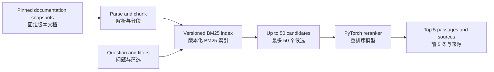

# DevSearch — Architecture and CPU Baseline / 代码架构与 CPU 基线

**2026-10-05 execution review:** the user now keeps MPS and CUDA as alternatives and wants a prepared run that requires no Python edits. Read [10 Execution contract](docs/10-accelerator-execution-contract.md), [11 Readiness gates](docs/11-readiness-and-review.md), and [12 Experiment estimates](docs/12-estimates-and-experiment-plan.md). These revision-4 requirements extend the reviewed architecture; they do not mark the scaffold or either backend ready.

**2026-10-05 执行评审：**用户现保留 MPS 与 CUDA 两种选择，目标是准备好后无需修改 Python 即可运行。新增第 10 号执行契约、第 11 号就绪门禁和第 12 号实验估算；这些第四版要求补充现有架构，不代表骨架或任何设备后端已经就绪。

Status, 2026-10-05: the CPU baseline **and the execution flow of the accelerator contract are implemented and checked on synthetic and diagnostic data only**. Every documented command now exists: `prepare` (pinned snapshots to a token-validated corpus), `prepare_data` (audited groups, training-only negatives, fixed candidates, review bank, two-stage test seals), `index`, `retrieve --mode baseline`, `train`, `predict`, `evaluate` (training-visible splits; the test split is reachable only inside a campaign), `export`, `serve`, and the campaign tools `doctor`, `plan`, `run`, `status`, `bundle`, `rehearsal`. A complete diagnostic campaign (preflight, calibration, locked plan, training, validation selection, final evaluation, export, reload verification, backup) runs from a wheel installed outside the checkout with the network blocked. **Not done, and not claimed:** any MPS or CUDA run (both backend gates are `unverified`), the pinned real MiniLM and tokenizer, a real labelled question set and review bank, human review, and any ranking-quality or latency number. The evidence, commands, results, blockers and next action are in [the accelerator-readiness evidence report](reports/accelerator-readiness-evidence.md) and the operator and schema reference is [docs/13](docs/13-operator-reference.md). Earlier records: [baseline verification](reports/baseline-verification.md).

状态，2026-10-05：CPU 基线**以及加速器执行契约的执行流程均已实现，仅在合成与诊断数据上检查**。文档中的全部命令均已存在：`prepare`（固定快照到长度校验语料）、`prepare_data`（分组审计、仅训练的负例、固定候选、审查库、两阶段测试封存）、`index`、`retrieve --mode baseline`、`train`、`predict`、`evaluate`（仅训练可见划分；测试划分只能在实验流程内访问）、`export`、`serve`，以及实验工具 `doctor`、`plan`、`run`、`status`、`bundle`、`rehearsal`。完整诊断流程（自检、校准、锁定计划、训练、验证选择、最终评测、导出、重载验证、备份）可由安装在检出目录之外且断网的 wheel 运行。**未完成且不宣称：**任何 MPS 或 CUDA 运行（两个后端门禁均为 `unverified`）、固定的真实 MiniLM 与分词器、真实标注问题集与审查库、真人审查，以及任何排序质量或耗时数字。证据、命令、结果、阻塞项和下一步见[加速器就绪证据报告](reports/accelerator-readiness-evidence.md)，操作与结构参考见 [docs/13](docs/13-operator-reference.md)。

**For the next AI: start with [the developer handoff](docs/08-ai-developer-handoff.md) and [implementation assignments](docs/09-implementation-assignments.md). Use only this directory as the GitHub repository root.**

**下一位 AI 请先读开发交接与任务分工。仅将本目录作为 GitHub 仓库根目录，不包含父工作区。**

## Checks and baseline quick start / 检查与基线快速开始

Use Python 3.11+ from this project directory. The package has no runtime dependencies and the baseline commands below need no model download, network or ML library (training, serving and the campaign tools need the `ml` and `serve` extras); the system Python 3.9.6 on the current Mac is not supported. The commands after the tests use only the tiny fixture corpus and example configs. Docs 03's other commands are implemented but have only been exercised on synthetic data (see the evidence report).

在项目目录内使用 Python 3.11+；包没有运行依赖，下列命令无需下载模型、联网或安装机器学习库，当前 Mac 的系统 Python 3.9.6 不受支持。测试之后的命令只使用微型样例语料和示例配置。03 中的其他命令已实现，但仅在合成数据上运行过（见证据报告）。

```sh
# Unit tests (CPU, standard library only)
PYTHONDONTWRITEBYTECODE=1 PYTHONPATH=src python -m unittest discover -s tests -v

# Try the baseline on the fixture. The runtime root must already exist and hold every artifact.
export PYTHONPATH=src DEVSEARCH_RUNTIME_ROOT=/path/to/an/existing/directory
mkdir -p "$DEVSEARCH_RUNTIME_ROOT/index" && cp -R tests/fixtures/mini_corpus "$DEVSEARCH_RUNTIME_ROOT/corpus"
python -m devsearch.index --config configs/index.toml \
  --corpus "$DEVSEARCH_RUNTIME_ROOT/corpus/corpus-manifest.json" \
  --output "$DEVSEARCH_RUNTIME_ROOT/index/index-manifest.json"
python -m devsearch.retrieve --config configs/search.toml --mode baseline \
  --index "$DEVSEARCH_RUNTIME_ROOT/index/index-manifest.json" --query "how do I load_state_dict"
python -m devsearch.validate_manifest --manifest "$DEVSEARCH_RUNTIME_ROOT/index/index-manifest.json"
```

The private GitHub repository is [Hector-sau/devsearch](https://github.com/Hector-sau/devsearch), with `main` as its default branch. The workflow has a dependency-free job (tests with ML and API tests reported as skips, wheel build, installed-wheel check; it ran once on GitHub on the earlier scaffold) and an `ml-cpu` job (CPU extras, the whole suite with any skip treated as failure) that **has not yet run on GitHub**; neither measures model quality or MPS; see [the baseline verification record](reports/baseline-verification.md) for completed and pending checks and the [earlier scaffold record](reports/scaffold-verification.md).

私有 GitHub 仓库为 [Hector-sau/devsearch](https://github.com/Hector-sau/devsearch)，默认分支为 `main`。CPU 工作流在 Python 3.11 与 3.12 上运行测试、构建 wheel 并检查安装后的 wheel，不验证模型效果或 MPS；已完成与待执行检查见[基线验证记录](reports/baseline-verification.md)及[此前的骨架记录](reports/scaffold-verification.md)。

## Read this first 阅读顺序

| Document 文档 | Purpose 用途 |
| --- | --- |
| [Architecture and roadmap 整体架构与路线](docs/00-architecture-and-roadmap.md) | System boundaries, lifecycle, release and execution order / 系统边界、生命周期、发布与执行顺序 |
| [Product and evidence 产品与成果](docs/01-product-and-evidence.md) | Users, scope, acceptance, personal contribution and résumé evidence / 用户、范围、验收、个人贡献与简历证据 |
| [Data and evaluation 数据与评测](docs/02-data-and-evaluation.md) | Data contracts, splits, labels, ranking metrics and experiments / 数据契约、划分、标签、排序指标与实验 |
| [Implementation 实现与运行](docs/03-implementation.md) | PyTorch training, configuration, device checks and reproducibility / PyTorch 训练、配置、设备探测与复现 |
| [Integration and decisions 集成与决策](docs/04-integration-and-decisions.md) | API, indexing, UI, milestones and decision log / 接口、索引、界面、阶段与决策记录 |
| [Machine handoff and execution 机器交接与执行](docs/05-machine-handoff.md) | User-provided Mac mini, migration, storage and ownership / 用户提供 Mac mini、迁移、存储与分工 |
| [Execution checklist 实施检查表](docs/06-execution-checklist.md) | Task dependencies, inputs, outputs and verification / 任务依赖、输入输出和验收 |
| [Review register 评审问题记录](docs/07-review-register.md) | Findings, corrections and remaining runtime evidence / 问题、修订及待实测证据 |
| [AI developer handoff 开发交接](docs/08-ai-developer-handoff.md) | Current code state, read order and a ready-to-use AI prompt / 代码现状、阅读顺序及可直接交接的提示词 |
| [Implementation assignments 实现分工](docs/09-implementation-assignments.md) | File ownership, first PR and dependent work / 文件归属、首个 PR 与依赖任务 |
| [Operator reference 操作参考](docs/13-operator-reference.md) | Commands, file schemas, stage graph, recovery, deviations and what is not proven / 命令、文件结构、阶段图、恢复、差异及未证明内容 |

The architecture blueprint is authoritative for overall boundaries and milestone order; the integration document owns API details and the decision log. The data specification owns dataset schemas and evaluation definitions; the implementation specification owns training contracts. Examples are illustrative unless marked as implemented.

整体架构文档管理系统边界与阶段顺序，集成文档管理接口细节和决策记录；数据规格管理数据结构与评测定义；实现规格管理训练契约。示例未标注为已实现时，均为设计示例。

## Outcome 项目成果

A developer enters an English technical question, selects a documentation source/version if needed, and receives relevant passages and code with traceable sources. BM25 retrieves candidates; a locally fine-tuned MiniLM cross-encoder can rerank them. Validation determines the default mode. A comparison view shows changes in ranking.

开发者输入英文技术问题，可选择资料来源或版本，获得带来源的相关段落和代码。BM25 召回候选，本地微调的 MiniLM cross-encoder 可对候选重排序，默认模式由验证结果决定；对比界面展示排序变化。英文问题与英文文档已由用户确认。



The first release returns evidence, without generated answers or autonomous actions. Practical utility is a hypothesis to test on independent technical queries; general Natural Questions results do not establish application-domain utility.

首版返回证据，不生成答案或执行自主操作。实际用途需要通过独立技术问题评测验证；Natural Questions 通用数据上的成绩不能直接证明技术文档场景有效。

## Delivery stages 交付阶段

| Stage 阶段 | Output 产物 | Gate 验收 |
| --- | --- | --- |
| M0 Contracts and resources 契约与资源 | Package/CPU/storage checks plus a separate target-model branch / 包、CPU、存储检查及独立目标模型分支 | Baseline can proceed before MPS; model probe must pass before M2 / MPS 排查不阻塞基线，M2 前模型探测须通过 |
| M1 Usable retrieval 可用检索切片 | Fixed docs, chunks, BM25 and development queries / 固定文档、切块、BM25 和开发问题 | Traceable results; distinguish corpus, recall and ranking failures / 结果可追溯，区分资料、召回和排序失败 |
| M2 Training and comparison 训练与对照 | Reviewed grouped data and initial test seal; tiny diagnostic, frozen vs full training / 分组审查数据及首次测试封存、小样本诊断、冻结与全量训练 | Reproducible recovery and fixed-candidate validation / 可复现恢复及固定候选验证 |
| M3 Domain adaptation 领域适配 | One controlled experiment; scale only with evidence / 一项受控实验，有依据再扩量 | Domain validation and measured resource budget; improvement not guaranteed / 领域验证与实测预算，不预设提升 |
| M4 Release candidate 集成候选版本 | Local API/UI and compatible release bundle / 本地接口界面与兼容发布包 | Failure paths, serving parity and operational checks / 异常路径、离在线一致与运行检查 |
| M5 Final evidence 最终评测交付 | Blind pool review, final qrels, shared comparison, local activation and verified backup / 盲审汇总池、最终标签、统一对比、本地激活与验证备份 | Reproducible delivery; personal-skill claims await independent user evidence / 交付可复现，个人能力声明另待用户独立证据 |

Build the BM25 application slice before large training runs. NQ expansion is optional and must be justified by domain validation. Targets are planning ranges, not promised counts or effects. Proceed when a gate passes; do not set a delivery date before hardware throughput and annotation effort are measured. A negative experimental result can pass evidence-quality checks but must not be called an improvement.

先完成 BM25 应用切片，再考虑大规模训练；NQ 扩量属于可选支线，需要领域验证支持。规模属于规划范围，不是承诺数量或效果。按验收推进，硬件吞吐和标注工作量实测前不承诺日期。没有提升的实验也可具备证据价值，但不能写成效果提升。

## Resources and scope 资源与范围

On 2026-10-05 the user chose to arrange a Mac mini M6 with 24 GB memory and delegated project transfer and execution to the assistant. That machine becomes the planned main runtime once accessible; no GPU-cloud purchase is needed. Routine setup, data preparation, training, evaluation and private project transfer to that machine are within scope. Additional paid services and public publication remain separate decisions. No target-machine setup or project training has started.

2026-10-05 用户决定自行安排 24 GB 内存的 Mac mini M6，并将项目迁移与运行交给助手。机器可访问后作为主要运行环境，无需采购云 GPU。常规环境配置、数据准备、训练、评估和向该机器私下迁移项目均在范围内。新增付费服务和公开发布仍另作决定。目前尚未配置目标机器或开始项目训练。

The preferred external root is `/Volumes/MAC专用/AI-Lab/pytorch/devsearch`; it was not mounted at the last check. For a physically delivered Mac mini, connect and verify the drive there. A remotely hosted Mac needs its own verified runtime path; the current Mac's external drive serves as a backup destination after mounting. The current MacBook Air has Apple M4, 16 GB memory, macOS 26.6.2 and arm64. Its existing PyTorch 2.8.0 passed a tiny MPS forward/backward/optimizer test outside the restricted sandbox. This does not validate the future Mac mini or MiniLM throughput. Do not create a replacement directory under an unmounted volume or silently install heavy assets onto the current MacBook's internal drive.

外置盘首选目录为 `/Volumes/MAC专用/AI-Lab/pytorch/devsearch`，最近检查时尚未挂载。如果收到实体 Mac mini，将盘连接该机器后验证；如果是远程托管 Mac，则使用该机器经检查的独立运行目录，当前 Mac 的外置盘挂载后作为备份位置。当前 MacBook Air 为 Apple M4、16 GB 内存、macOS 26.6.2 与 arm64；已有 PyTorch 2.8.0 在受限沙盒外通过极小型 MPS 前向、反向及参数更新测试。这不能证明未来 Mac mini 或 MiniLM 的性能。不得在未挂载卷名下创建替代目录，也不得静默将大体积资产装进当前 MacBook 内置盘。

## Completion definition 完成定义

Engineering completion requires usable search, an explainable PyTorch implementation, credible held-out evaluation, a verified portable release and reproducible evidence. Track the user's independent explanation/modification separately before making personal-mastery claims. Simulated queries remain labeled as simulated; only an actual participant study can support claims about users or time saved by people.

工程完成标准是可用检索、可解释的 PyTorch 实现、可信独立评测、经验证的便携发布包及可复现证据。用户独立解释和修改单独跟踪，完成前不声称个人已掌握。模拟问题始终标注为模拟；只有实际参与者测试才能支撑真人使用或人工时间节省的表述。
