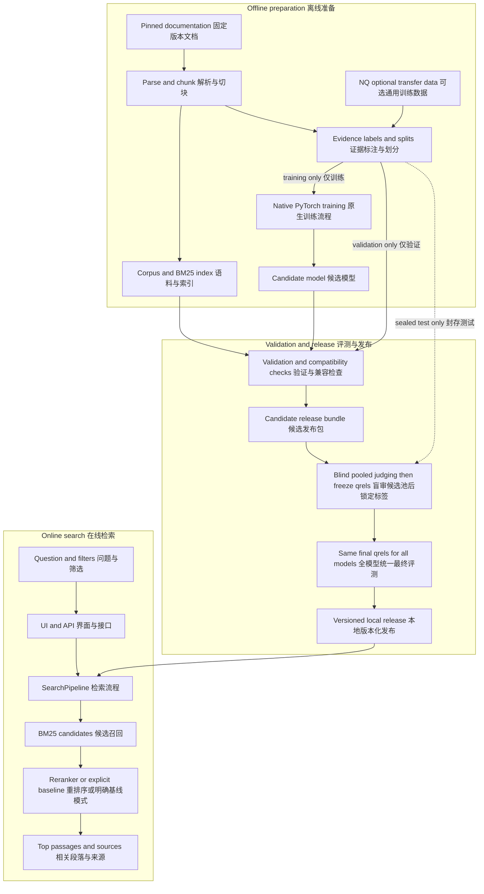
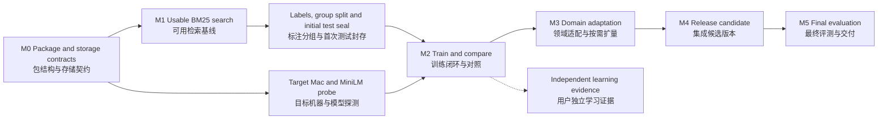

# DevSearch Architecture and Roadmap / DevSearch 整体架构与执行路线

**Revision-4 execution addendum:** [10](10-accelerator-execution-contract.md), [11](11-readiness-and-review.md), [12](12-estimates-and-experiment-plan.md) define dual MPS/CUDA profiles, full-candidate pre-review, bounded automated runs and acceptance. They supersede older Mac-only assumptions and the required timing of new test judgments for the selected pre-review mode. The system architecture below remains the base; new orchestration is a module in the same package. Implementation status remains separate.

**第四版执行补充：**第 10～12 号文档规定双设备、全候选预审、有界自动运行及验收；替代旧的仅 Mac 假设，并在选择预审模式时调整新增测试审查的发生时间。下文保留为基础架构，新增编排仍在同一包内，实现状态另计。

Design revision 3, reviewed 2026-10-05. The project is an English technical-documentation search application with a trainable PyTorch reranker. This blueprint defines system boundaries, data lifecycle, execution order and acceptance gates. Revision 3 resolves the multi-agent review findings recorded in the [review register](07-review-register.md), with an [execution checklist](06-execution-checklist.md) for implementation. Design review does not establish runtime correctness or measured quality.

设计修订版 3，评审日期 2026-10-05。本项目是具有 PyTorch 可训练重排序模块的英文技术文档检索应用。本文定义系统边界、数据生命周期、执行顺序与验收条件。第三版修订多 Agent 评审问题，留存问题记录，并提供实施检查表。设计评审不能代替实际运行验证或效果实测。

## 1. Product outcome / 产品目标

A developer asks a question and finds a traceable official explanation or code example. The first release covers three task families: checkpoint and training-state recovery; train/eval behavior and gradient control; Transformers tokenization and model loading. Broader coverage is an extension, not an initial promise.

开发者提出问题后，能找到可追溯的官方解释或代码示例。首版集中覆盖三类任务：checkpoint 与训练状态恢复、train/eval 和梯度控制、Transformers 分词与模型加载。更广覆盖属于扩展目标，不作为首版承诺。

For each development query, record the intended task, source evidence, retrieved passage and whether the source/code remains complete. Initial questions are development fixtures, not a user study or held-out test. Start with about 30–50 reviewed development queries, including valid searches and error states; adjust the number to actual coverage.

每条开发问题记录任务、原文证据、返回段落，以及来源与代码是否完整。初期问题属于开发样例，不是真人研究或独立测试。先准备约 30～50 条经审查的开发问题，覆盖正常查询与异常状态，数量随实际覆盖调整。

The product returns evidence and source links. Generated answers, autonomous agents, authentication and public multi-user hosting are out of scope. Practical value is evaluated on technical queries; learning PyTorch is demonstrated through native training code and independent explanation, rather than through the documentation's subject alone.

产品返回证据与来源链接，首版不包含生成答案、自主 Agent、登录或公开多用户托管。实际价值通过技术问题评测验证；PyTorch 能力通过原生训练代码与独立解释证明，不能只凭资料主题是 PyTorch 来证明。

## 2. System design / 系统架构

Use a modular monolith: one Python package, shared core logic, offline commands, one local API process and a thin interface. The UI never loads a second model. Training and serving share the model wrapper and pair encoder; CLI and API share the same SearchPipeline. This keeps a single-developer project reproducible and understandable.

采用模块化单体：一个 Python 包、共享核心逻辑、离线命令、一个本地 API 进程和轻量界面。界面不另外加载模型。训练与服务复用模型封装及问题—段落编码；CLI 与 API 复用 SearchPipeline，使个人项目容易复现和解释。



The diagram summarizes the flow. Only training-owned queries, evidence groups and labels feed formal training and negative mining; validation guides selection. Test questions, initial judgments and pooling rules are sealed before formal training comparisons. Earlier compatibility probes use independent diagnostic fixtures, never held-out material, and their weights do not initialize formal comparisons. After systems are locked, blind pooled judging produces final judgments shared by every model before scoring; it never reopens tuning. See the data specification for both seals. Live queries do not automatically feed training.

图中是总体流向；正式训练及负采样仅使用训练归属问题、证据组和标签，验证集用于选择。正式训练比较前封存测试问题、初始标注与候选汇总规则。此前兼容探测只使用独立诊断样例，不读留出资料，诊断权重也不作为正式对照起点。锁定系统后，盲审候选池形成统一最终标注再一起评分，不再打开调参。两次封存见数据规格，线上问题不自动回流训练。

### Architecture decisions / 架构决策

| Decision / 决策 | Rationale / 理由 | Change trigger / 何时调整 |
| --- | --- | --- |
| BM25 first, reranker as a replaceable component / 先 BM25，再接可替换重排模块 | Expose corpus and recall problems early / 尽早发现语料与召回问题 | Consider another retriever only if validation failures justify it / 验证失败明确指向召回瓶颈时再考虑其他召回器 |
| MiniLM with native PyTorch loop / MiniLM 加原生 PyTorch 训练 | Keep training mechanics visible / 训练机制可见、可解释 | Change size or architecture only after measured constraints / 根据实测资源与效果调整 |
| Local files and immutable manifests / 本地文件及不可变清单 | Reproduce data/model/index combinations / 可复现数据、模型、索引组合 | Database or remote artifact store only if scale requires it / 规模确有需要时再增加数据库或远程产物库 |
| FastAPI plus thin Streamlit UI / FastAPI 加轻量 Streamlit 界面 | Demonstrate an application without duplicating ranking logic / 展示应用，避免重复排序逻辑 | UI can change without changing the pipeline / 替换界面不影响核心流程 |
| Single worker, sequential accelerator use / 单 worker、加速设备错时使用 | Prevent training/inference contention / 避免训练推理竞争资源 | Increase concurrency after a separate load benchmark / 单独压测后再提高并发 |
| No response cache in v1 / 首版不开响应缓存 | Easier correctness and honest latency measurement / 简化一致性与性能测量 | Add only after profiling, using full release-aware keys / 性能分析后再引入完整版本缓存键 |

The exact BM25 package, dependency versions and source revisions are resolved and locked in M0/M1. These are compatibility decisions, not repeated scope questions. The user will supply a Mac mini for execution; no additional paid service or external model API is required for search.

BM25 具体依赖、库版本和来源 revision 在 M0/M1 检查后锁定。这些是兼容性决策，无须反复让用户选择项目范围。用户将提供 Mac mini 用于执行；搜索不需要新增付费服务或外部模型 API。

## 3. Module ownership / 模块职责与边界

| Module / 模块 | Owns / 负责 | Contract / 契约 |
| --- | --- | --- |
| ingestion | Pin, read and normalize allowed documentation / 固定、读取并规范化文档 | Source snapshot → normalized documents with source mapping / 来源快照→带映射正文 |
| data | Structural chunks, labels, grouping and pair encoding / 结构切块、标签、分组、样本编码 | Versioned corpus, splits and training pairs / 版本化语料、划分与训练对 |
| retrieval | Build/load BM25, filter before retrieval / 构建加载 BM25、召回前筛选 | Query + filters → ordered candidate IDs / 问题筛选→有序候选 ID |
| modeling | MiniLM encoder, scoring head and batch scoring / 编码器、评分层与批量打分 | Validated pairs → one finite logit per pair / 合格输入对→单个有限 logit |
| training | Optimizer, loop, validation and checkpoint recovery / 优化器、循环、验证与恢复 | Train/validation inputs → candidate checkpoint and logs / 训练验证→候选模型与日志 |
| evaluation | Fixed candidates, metrics, diagnostics and timing / 固定候选、指标、诊断和计时 | Immutable inputs → reproducible report / 不可变输入→可复现报告 |
| artifacts | Hashes, manifests, compatibility and release pointer / 哈希、清单、兼容与激活指针 | Approved combination → local release / 经检查组合→本地发布版本 |
| serving | SearchPipeline, request validation and fallback / 检索编排、请求验证与降级 | Request + loaded release → results / 请求与已加载版本→结果 |
| ui | Query input and before/after presentation / 输入与前后对比 | Calls API only / 只调用接口 |

These are package boundaries, not separate services. Implement small modules first and split files when needed. Core modules do not depend on UI code. Offline evaluation invokes the same retrieval and scoring functions used by the service, so there is one definition of filtering, tokenization and tie-breaking.

这些是代码模块边界，不是多个独立服务。先实现小模块，按实际复杂度拆文件；核心模块不依赖界面。离线评测调用与服务相同的检索和评分函数，保证筛选、编码和同分处理只有一套定义。

Proposed repository layout, with existing documentation retained:

建议仓库结构，保留已有文档：

```text
devsearch/
  README.md
  docs/
  configs/                 # sources, data, train, evaluate, serve
  src/devsearch/
    ingestion/ data/ retrieval/ modeling/
    training/ evaluation/ artifacts/ serving/
    prepare.py prepare_data.py index.py validate_manifest.py
    train.py evaluate.py predict.py retrieve.py serve.py export.py  # thin CLI
  ui/
  tests/                   # unit, integration, small fixtures
  reports/                 # compact tracked summaries
  pyproject.toml
  <dependency lock>
```

Environment, downloads, datasets, indexes, checkpoints and full logs live under a host-specific runtime root, preferring attached external storage. Remote hosts have independent paths; see [machine handoff](05-machine-handoff.md). A schema-versioned JSON manifest is the artifact contract; no orchestration platform is required.

环境、下载、数据集、索引、模型及完整日志放主机专属运行目录，优先连接的外置盘。远程主机路径独立，见机器交接文档。带 schema 版本的 JSON 清单作为产物契约，不需要额外编排平台。

## 4. Data and learning lifecycle / 数据与训练生命周期

### Two sources serve different purposes / 两类数据承担不同职责

The domain corpus comes from pinned PyTorch Tutorials and Transformers documentation. It supplies real searchable content and domain supervision. Natural Questions is an optional source for training diagnostics and transfer experiments; completing 50k NQ questions is not a prerequisite for a useful application.

领域语料来自固定版本的 PyTorch Tutorials 与 Transformers 文档，提供实际检索内容和领域监督。Natural Questions 是可选的训练排错与迁移实验来源；完成 5 万条 NQ 训练不是应用有用的前提。

The domain target remains 500–1,000 training questions, a separate validation set and 200–300 test questions, subject to reviewed sample availability. Build a smaller usable subset first. Larger generic-data tiers of 10k/30k/50k are optional experiments approved by validation evidence and resource estimates, not mandatory milestones.

领域目标仍为 500～1,000 条训练问题、独立验证集及 200～300 条测试问题，以审查后的可用数量为准；先完成更小子集。通用数据 1万／3万／5万档位属于可选实验，由验证结果和资源估算决定，不是必须走完的阶段。

| Partition / 划分 | Permitted use / 允许用途 | Must not / 禁止用途 |
| --- | --- | --- |
| Development / 开发样例 | Debug parsers, display and known failure cases / 排查解析、界面和已知错误 | Relabel as unseen final tests / 改名冒充独立最终测试 |
| Training / 训练 | Gradients and pairs from training-owned queries/chunk groups / 基于训练归属问题与段落组构造梯度输入和样本 | Use held-out groups, questions or labels for mining / 用留出组、问题或标签挖掘负例 |
| Validation / 验证 | Choose checkpoints, retrieval parameters and scaling / 选择模型、召回参数和扩量 | Report as untouched test performance / 宣称未见测试成绩 |
| Sealed test / 封存测试 | Final predeclared comparison and report / 预先固定的最终比较与报告 | Tune again and reuse the same independence claim / 据此继续调参后仍声称独立 |

Group paraphrases and overlapping/duplicated evidence before assigning partitions; freeze source/task coverage and report independent group counts. The shared search index contains all eligible corpus chunks, while training mining uses only training-owned chunk groups. This measures new questions on a shared index, not unseen-document generalization. Keep synthetic provenance, evidence, reviewer type and status separate. Test ambiguity follows predeclared rules applied without model identities or scores; a difficult question or retrieval miss is never an exclusion reason.

同义改写和重叠、重复证据先分组再划分，冻结来源与任务覆盖并报告独立组数。共享检索索引包含全部合格语料，训练挖掘仅使用训练归属的段落组。主协议衡量共享索引上的新问题，不代表新文档泛化。合成来源、证据、审查者类型和状态分别记录。测试歧义按预定规则处理，审查时隐藏模型身份与分数；题目较难或模型漏检不能作为排除理由。

### Learning decisions / 模型实验决策

Start with a native PyTorch diagnostic on 32–64 pairs, then a manageable training subset. Compare BM25, a frozen encoder with a trained head, and full fine-tuning on identical validation candidates. Start from the same pretrained encoder when comparing frozen and full training. Record which data and training budget each condition uses.

先做 32～64 对样本的原生 PyTorch 诊断，再使用可管理训练子集。在同一验证候选上比较 BM25、冻结编码器训练评分层、全量微调；冻结和全量对照从相同预训练编码器出发，记录各条件的数据与训练预算。

Diagnose before scaling: missing source evidence requires corpus work; missed retrieval requires parser/chunk/tokenization/retriever work; poor ordering after successful recall is a reranker problem. If negatives are too easy, change sampling; if domain coverage is narrow, expand domain labels; expand NQ only when transfer helps domain validation. Change one main factor per controlled comparison.

扩量前先诊断：原文无证据就补语料；未召回就检查解析、切块、分词和召回器；已召回但排名差才属于重排问题。负例太简单则改采样，领域覆盖不足则补领域标签，NQ 迁移对领域验证有帮助时才扩大 NQ。每组受控对比只改变一个主要因素。

## 5. Version dependencies and invalidation / 版本依赖与失效传播

Every run reads immutable manifests. Lineage is a dependency graph, not a folder named `latest`. Store the code revision, source/model revisions, configuration, seed, split hashes, corpus/index IDs and per-query outputs alongside aggregate metrics.

每次运行读取不可变清单。溯源依赖明确的版本关系，而不是名为 `latest` 的文件夹。汇总指标旁保存代码版本、来源和模型版本、配置、种子、划分哈希、语料索引 ID 及每题输出。

| Changed input / 发生变化 | Required action / 必须处理 | Can remain / 可保留 |
| --- | --- | --- |
| Source text, parser or chunker / 原文、解析或切块 | New corpus; recheck labels and rebuild index/candidates/reports / 新语料，复核标签并重建索引候选报告 | Old snapshots and model weights remain traceable / 旧快照与模型权重保留溯源 |
| Relevance judgments / 相关性标注 | New qrels and report; new run if training labels change / 新标注版本与报告，训练标签变化则另开训练 | Unchanged corpus and index / 未变语料索引 |
| BM25 parameters or candidate depth / BM25 参数或候选数 | New index/config and candidates; all compared models reevaluated / 新索引或配置及候选，所有对比模型重评 | Weights need not be retrained automatically / 不必自动重训权重 |
| Tokenizer or pair-length policy / 编码器或长度规则 | Revalidate all input lengths/evidence and compatibility / 重新检查输入长度、证据及兼容性 | Old artifacts under their old contract / 原契约下的旧产物 |
| Model weights / 模型权重 | New model ID, evaluation and release candidate / 新模型 ID、评估和候选版本 | Compatible fixed corpus and candidates / 兼容的固定语料与候选 |

A model trained on NQ may serve technical documents: training-corpus hashes do not need to equal serving-corpus hashes. Compatibility instead requires the serving index to match its corpus, and the model/tokenizer/length contract to encode that corpus correctly. Utility must still be evaluated on the domain.

NQ 训练模型可以用于技术文档，训练语料哈希不必等于服务语料哈希。兼容性要求是服务索引匹配其语料，模型／tokenizer／长度契约能正确编码当前语料；是否有用仍须领域评测。

## 6. Serving and release lifecycle / 服务与发布生命周期

One API worker loads the active release once; the UI calls it. Per request: validate → apply filters → retrieve candidates → score permitted batches → deterministic ranking → return passages and source metadata. BM25-only mode is always available when the index is healthy. Reranking failures produce explicitly labeled fallback, not an unmarked change in algorithm.

一个 API worker 启动时加载当前发布版本，界面通过接口调用。每次请求依次完成：校验→筛选→召回→分批评分→确定性排序→返回段落及来源。索引正常时保留 BM25-only 路径；重排失败必须明确标注降级，不静默换算法。

V1 admits one active search, with no waiting search queue, through a process-local executor as specified in the integration contract. Health checks remain responsive. The slot remains occupied until the worker and submitted device work finish, even after a client timeout. Use a measured deadline checked between batches, discard all partial reranking on failure, and return a busy response on excess admission. Do not promise kernel cancellation. Training and reranking service do not share the accelerator concurrently; any later concurrency increase needs its own benchmark.

首版按集成契约，使用进程内执行器接纳一个活动搜索，不设等待搜索队列，健康检查仍可响应。即使客户端已超时，许可也占用到工作线程和已提交设备任务结束。在 batch 之间检查实测确定的时限，失败时丢弃全部部分重排，超量请求返回忙碌；不承诺中断 kernel。训练与服务重排不同时占用加速器，提高并发须另行压测。

A schema-versioned manifest contains artifact IDs/hashes, tokenizer revision, encoding policy, inference configuration, dependency lock hash and validation-report ID. Distinguish `status: candidate|evaluated`: a candidate has `final_report_id: null` and may be loaded explicitly for development, compatibility and performance checks. M1 baseline development runs likewise need no final report. Only an evaluated manifest with its final report can become the completed local release.

带 schema 版本的清单包含产物 ID／哈希、tokenizer 版本、编码规则、推理配置、依赖锁与验证报告 ID。区分 `status: candidate|evaluated`：候选的 `final_report_id` 为 null，可显式加载用于开发、兼容及性能检查；M1 基线开发同样不需要最终报告。只有具备最终报告的 evaluated 清单，才能成为完整交付的本地发布版本。

The final report references the immutable candidate and its artifact hashes. After evaluation, create a new immutable release manifest that references both candidate and report; never edit the candidate in place or create a hash cycle. An explicit baseline release may have `model_id: null`; model-only compatibility fields are conditional on reranking capability. Startup verifies required files and compatibility for the selected status. Damaged required artifacts block activation; a later model runtime failure may trigger explicit baseline fallback. Inference artifacts exclude optimizer state, and queries never download missing assets.

最终报告引用不可变候选及其产物哈希；评测后另建不可变发布清单，同时引用候选和报告，不原地修改候选，也不形成循环哈希依赖。明确基线版本可设 `model_id: null`，仅模型相关兼容字段按重排能力条件校验。启动按状态验证必需文件及兼容性，必需产物损坏时拒绝激活；模型之后发生运行错误时才可明确降级。推理产物不含优化器状态，查询不下载缺失资源。

Lifecycle: build immutable candidate → validate artifacts and domain behavior → freeze choice and evaluate sealed test → stop service → switch local active pointer → restart and check readiness. Preserve the previous release and restore it on operational failure. V1 does not need hot swapping. Test results must not be used to repeatedly select different models; if they invalidate the intended benefit, report that finding and withhold the improvement claim.

生命周期为：生成不可变候选→检查产物及领域行为→锁定选择并评测封存测试→停服→切换本地激活指针→重启并检查就绪。保留上一版本，运行故障时恢复。首版不做热更新；不能根据测试结果反复挑选模型，若测试不支持预期收益，就报告该发现并撤下提升声明。

The default ranking mode is chosen from validation quality and latency before final testing. A completed experiment and a useful default reranker are different outcomes. If validation favors BM25, deliver BM25 as default with reranking available in a clearly marked experiment view. A final test can block a claim or release, but does not authorize retuning on that test.

默认排序模式在最终测试前，依据验证效果与耗时确定。实验完成和模型值得默认启用是两个结论。验证更支持 BM25 时，以 BM25 为默认，并保留明确标识的重排实验视图。最终测试可以阻止发布或效果宣称，但不能成为在同一测试集上调参的许可。

Heavy assets remain under the configured runtime root on the execution host. When that root is an external disk, verify the actual mount before writes; if unavailable, fail clearly rather than redirect to internal storage. Remote execution uses a separate verified root and transfers deliverables back as specified in the handoff. Data or model loss during service causes explicit unavailability or a verified baseline fallback. Use local structured logs for request ID, release, effective mode, counts, timing and errors; full query logging is off by default.

大体积产物保留在执行主机所配置的运行目录。目录位于外置盘时，写入前验证真实挂载，不可用时明确停止，不改写到内置盘。远程运行使用独立且经验证的目录，按交接要求传回交付物。服务期间数据或模型丢失时明确不可用，或在基线资源仍经确认可用时降级。本地结构化日志记录请求 ID、版本、实际模式、数量、耗时和错误，默认不保存完整查询。

## 7. Execution roadmap / 整体执行路线



| Stage / 阶段 | Main work and artifact / 工作与产物 | Exit condition / 进入下一阶段的条件 |
| --- | --- | --- |
| M0 Contracts and resources / 契约与资源 | Package, CPU fixtures, storage/source/schema checks; separate target-model probe / 包结构、CPU 样例、存储来源结构检查；独立目标模型探测 | CPU/package/storage checks unlock M1; target MiniLM probe is required before M2 / CPU、包与存储通过可进入 M1，MiniLM 探测在 M2 前必须通过 |
| M1 Usable retrieval / 可用检索切片 | Parse docs, build index and model-free baseline, inspect development queries; prepare grouped labels in parallel / 解析建索引与无模型基线、检查开发问题，并行准备分组标注 | Sources/code trace correctly; coverage and split report plus initial test seal required before M2 / 来源代码可追溯，M2 前完成覆盖划分报告和首次测试封存 |
| M2 Training and comparisons / 训练闭环与对照 | Tiny diagnostics, labeled subset, frozen/full comparison and recovery checks / 小样本诊断、标注子集、冻结与全量对照、恢复检查 | Fixed candidates, clean split boundaries and resume equivalence; learning evidence tracked separately / 固定候选、划分清晰、恢复一致性通过，学习证据单独跟踪 |
| M3 Domain adaptation / 领域适配与按需扩量 | Improve one data/training factor, then expand only when evidence supports it / 改进一项数据或训练因素，有依据再扩量 | Complete controlled report, domain validation and time/memory estimate / 完整受控实验报告、领域验证和时间内存估计；不要求强行得到提升 |
| M4 Release candidate / 集成候选版本 | Complete local API/UI, release manifest, failure paths, serving parity and performance checks / 完成本地接口界面、发布清单、异常、训练服务一致与性能检查 | Candidate reproducible and loadable; ranking mode chosen using validation / 候选可复现可加载，验证集决定排序模式 |
| M5 Final evidence / 最终评测与交付 | Blind pool review and final seal, shared-qrels comparison, local activation, fresh install and verified backup / 盲审汇总池与最终封存、统一标注比较、本地激活、干净安装和备份验证 | Reproducible app/report/delivery; personal-mastery claims await independent demonstration / 应用报告交付可复现，个人掌握声明另待独立演示 |

The critical path is usable data → trustworthy evaluation → trainable model → validated application. CPU-based ingestion/BM25 can proceed while target-model compatibility is being checked, provided storage is verified. M2 requires both the target-model gate and data-readiness gate: reviewed usable training/validation data, group ownership, coverage, fixed validation candidates and the initial test seal. No required dataset remains merely a target count at that gate. API polish and large training runs do not block early product verification.

关键路径是可用数据→可信评测→可训练模型→经过验证的应用。存储通过检查后，CPU 采集和 BM25 可与目标模型兼容检查并行。M2 同时要求模型门禁与数据就绪门禁：已审查可用训练／验证数据、分组归属、覆盖表、固定验证候选及首次测试封存；必须的数据不能仍停留在目标数量。界面美化和大规模训练不阻塞早期产品验证。

Each milestone ends with an executable entry point, an artifact manifest, a short result report and a next-step decision. Calendar estimates are made after M0 throughput and M1 labeling effort are known. Successful diagnostics are prerequisites for scaling, not résumé accuracy results.

每个阶段结束时必须有可执行入口、产物清单、简短结果报告和下一步决定。日历工期在 M0 吞吐及 M1 标注成本明确后估算；排错成功是扩量前提，不能作为简历准确率成绩。

Track `engineering_status` separately from `learning_evidence_status`. Passing engineering gates permits autonomous progress even when the user has not completed an exercise. Deliver the explanation and a small modification task at M2; only personal mastery and résumé statements depend on the user's independent demonstration. This never substitutes agent review for human evidence.

分别记录 `engineering_status` 和 `learning_evidence_status`。工程检查通过即可自主继续，用户尚未完成练习不阻塞开发。M2 交付讲解和小修改任务；个人掌握与简历相关声明仍需用户独立演示，不能用 Agent 审查代替人工证据。

## 8. Quality gates and observability / 质量门禁与可观测性

| Gate / 检查 | Required evidence / 必需证据 |
| --- | --- |
| Data correctness / 数据正确 | Source mapping, code preservation, length/evidence checks, group overlap report, label provenance / 来源映射、代码保留、长度证据检查、交叉分组报告与标签来源 |
| Training correctness / 训练正确 | Hand-checked batches, finite gradients, parameter updates/freezing, checkpoint round trip / 人工可核对 batch、有限梯度、更新冻结和模型重载 |
| Evaluation correctness / 评测正确 | Hand-computable ranking fixtures, all-query inclusion, fixed candidates, no inserted positives / 可手算排序样例、全部问题计入、固定候选、不补正例 |
| Service correctness / 服务正确 | Filter/error/fallback tests, same scoring as offline, release compatibility / 筛选错误降级测试、离在线评分一致、发布兼容 |
| Performance / 性能 | Warmup, synchronized timing, named hardware, token/batch/concurrency settings, p50/p95 / 预热同步计时、硬件、长度批量并发设置及 p50/p95 |
| Evidence integrity / 证据真实 | Per-query outputs, failed experiments, reviewed limitations, traceable résumé claims / 每题结果、失败实验、审查局限及可追溯简历陈述 |

MRR@10 is the proposed primary ranking metric; Recall@50 diagnoses retrieval, and nDCG@10 is supplementary. With one known positive, these metrics share information and are not independent proof. Track parse failures, length exclusions, unsupported-version requests, reranking errors and fallback rate. Latency targets and acceptable quality trade-offs are recorded after the baseline and before model selection, not retrofitted to test outcomes.

MRR@10 作为拟定主要排序指标，Recall@50 诊断召回，nDCG@10 作为补充。单已知正例情况下，这些指标相关，不能当作多份独立证明。同时记录解析失败、长度排除、非法版本、重排错误与降级率。延迟目标和可接受效果取舍在基线后、模型选择前记录，不能看到测试结果才修改。

## 9. Responsibilities and decisions / 分工与决策

The assistant can implement modules, transfer the project and execute experiments on the user-provided Mac, prepare annotation drafts, audit records and package reports. Reviewer provenance must distinguish agent checks from actual human review. The user arranges the machine and access, then participates in three focused checkpoints: trying 5–10 development searches; confirming a small set of ambiguous label examples; independently explaining and changing training code before final résumé use. These are planned activities, not completed user tests.

助手可以实现模块、迁移项目并在用户所提供的 Mac 上执行实验、准备标注初稿、检查记录与整理报告。审查来源必须区分 Agent 检查和真实人工审核。用户安排机器及访问，之后集中参与三个环节：体验 5～10 条开发查询、共同确认少量歧义标注、在最终使用简历前独立解释并修改训练代码。这些是计划安排，不是已完成的用户测试。

Already decided: English first; Markdown documentation in the current workspace; user-provided Mac mini M6 with 24 GB memory as the future main runtime; external storage preferred, with host-specific paths for remote execution. Engineering defaults: modular monolith, BM25 and MiniLM, no response cache, single API worker, no additional paid service and no public deployment. The assistant owns routine project transfer, setup and execution once access is available.

已决定：英文首版、当前工作区 Markdown 文档、用户提供的 24 GB Mac mini M6 作为未来主运行机、优先外置盘且远程路径按主机配置。工程默认：模块化单体、BM25 与 MiniLM、无响应缓存、单 API worker、不新增付费服务、不公开部署。机器可访问后，助手负责常规项目迁移、配置与执行。

Ask the user when a concrete decision exceeds the supplied resources or scope: rental extension or other added costs; a material expansion of domain or language; paid generation; or public publication. No rental listing is needed before the user has arranged the machine. Device capacity, exact package pins, clean sample counts and useful batch sizes are measured implementation parameters. They cannot be truthfully guaranteed by architecture alone.

具体决定超出所提供资源或范围时再与用户沟通：续租或其他新增费用、领域或语言明显扩展、付费生成、公开发布。用户安排机器前无需租赁链接。设备容量、精确依赖、清洗后数量与合适 batch 都属于实测参数，无法仅凭架构设计如实保证。

## 10. Reference specifications / 配套规格

This document owns overall architecture and milestone dependencies. [Product](01-product-and-evidence.md) owns user-facing behavior and evidence; [data](02-data-and-evaluation.md) owns schemas and evaluation; [implementation](03-implementation.md) owns training and CLI contracts; [integration](04-integration-and-decisions.md) owns API/release semantics; [handoff](05-machine-handoff.md) owns machine operations. The [execution checklist](06-execution-checklist.md) maps those contracts to tasks; the [review register](07-review-register.md) records findings and deferred runtime evidence. Reconcile cross-document changes in one revision.

本文管理架构与阶段依赖；产品文档管理使用行为和证据，数据文档管理结构与评测，实现文档管理训练和 CLI，集成文档管理 API 与发布语义，交接文档管理机器运行。实施检查表将契约映射到任务，评审记录保存发现和待实测证据。跨文档变更须在同一修订中统一。

Source references: [PyTorch Tutorials](https://github.com/pytorch/tutorials), [Transformers documentation](https://github.com/huggingface/transformers/tree/main/docs), [Natural Questions pairs](https://huggingface.co/datasets/sentence-transformers/natural-questions), [MiniLM model card](https://huggingface.co/microsoft/MiniLM-L12-H384-uncased), and [Sentence Transformers training example](https://github.com/huggingface/sentence-transformers/blob/main/examples/cross_encoder/training/rerankers/training_nq_bce.py). These are upstream references, not promises of compatibility or measured performance; pin and check them before execution.

以上是上游代码和数据参考，不是兼容或性能保证；执行前固定版本并检查。系统划分、阶段顺序、数据扩量规则及发布流程均为本项目设计决策。
