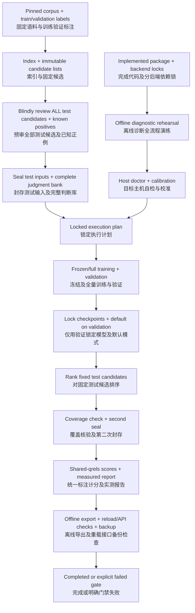

# Accelerator execution contract / 加速设备执行契约

Revision 4 execution addendum, 2026-10-05. The user now keeps **Apple MPS and NVIDIA CUDA** as alternatives. This document defines the requested end state: a prepared, tested bundle that an operator can run without editing Python. It does not certify GPU readiness or promise that unknown hardware never fails. Review started at main `30927a4` and incorporated the newly pushed CPU baseline branch at `ee4edea2d53e103119b5f45fe4f1278e4f478499`; its 125 fixture tests passed independently on Python 3.12.14. Unpushed/later work remains outside this snapshot; see [verification](../reports/execution-review-verification.md).

第四版执行补充，2026-10-05。用户现保留 **Apple MPS 与 NVIDIA CUDA** 两种选择。目标是交付经过准备与验证的运行包，操作者无需修改 Python 即可执行；本文不代表 GPU 已就绪，也不保证未知硬件永不出错。评审起于主分支骨架，并补查上述新推送 CPU 基线提交，其 125 项样例测试已在 Python 3.12.14 独立通过。未推送或之后的新改动不在本快照范围内，见验证记录。

## 1. Ownership and definition of done / 责任与完成定义

The implementing AI owns code, dependencies, data preparation/review, packaging, automated tests and this execution path. The user supplies an accessible host, permitted durable storage and an availability window. Initial setup may need network access; the formal campaign must run from prepared local assets. No new paid model calls or compute purchase is authorized by this document. CPU parsing, tokenization, metrics and report generation remain part of a GPU campaign.

开发 AI 负责代码、依赖、数据准备与审查、打包、自动测试和执行流程。用户提供可访问的机器、允许使用的持久存储及可用时间。初次安装可联网，正式实验必须使用已备好的本地资产；本文不授权新增付费模型调用或算力采购。GPU 实验仍包含 CPU 解析、分词、指标计算及报告生成。

Track four independent gates: `implementation_verified`, `data_ready`, `portable_bundle_verified`, and `backend_verified[profile]`. `accelerator_run_ready[profile]` is true only when all four pass for the exact code/data/profile identity and a complete diagnostic rehearsal succeeds. A new host first runs automated preflight/calibration; unknown drivers or failed operators produce a specific failed gate, not an instruction to improvise source edits during training. The [readiness review](11-readiness-and-review.md) owns the evidence checklist.

For a Linux CUDA container without network-namespace permission, portable evidence may come from the same-release Linux/x86_64
CI job through the explicit, operator-pinned import in GPU_QUICKSTART §0.2. The receipt retains its CI host attribution and positive
control. The exact tested wheel, dependency hashes, full deployment inventory and successful workflow provenance are verified.
The target must independently pass locked installation inspection, zero-skip implementation tests, real-model diagnosis and
CUDA doctor/calibration. This is a change in where portability is proved, not a claim that the rental is network-isolated.

受限 CUDA 容器可显式导入同版本 Linux CI 便携性证据，保留 CI 来源及隔离正向对照；核对安装包、依赖、部署文件和工作流。本机仍须独立通过锁定安装检查、零跳过测试、真实模型诊断及 CUDA 校准。不能声称租用容器已经网络隔离。

独立记录实现、数据、便携包、各后端验证四项门禁。只有确切代码／数据／配置身份下四项均通过，并完成诊断全流程演练，才能将该配置标为可运行。新机器首先自动自检和校准，驱动未知或算子失败应返回具体失败门禁，不要求在训练过程中临时改源码。证据检查表见就绪评审。

## 2. Runtime architecture / 运行架构

Keep the existing modular monolith. Add `execution/` for a small sequential controller and thin `doctor`, `plan`, `run`, `status` entry points; it calls existing module APIs instead of duplicating training or search. Module A owns plan/state/config integration; B owns sealed evaluation inputs; C owns device/training probes; D owns offline export and API/UI acceptance, following document 09. No task queue or distributed scheduler is needed.

保留现有模块化单体，新增 `execution/` 小型顺序控制器及薄命令入口；调用已有模块接口，不重复实现训练或搜索。按第 09 号文档分工，A 负责计划／状态／配置集成，B 负责封存评测输入，C 负责设备训练探测，D 负责离线导出和接口界面验收。不引入任务队列或分布式调度平台。



This is the recommended `prejudged_fixed_candidates_v1` path. The original `postrank_pool_v1` path remains supported, but adds an `awaiting_review` boundary between ranking and final sealing. Neither path permits test-based selection. The machine-readable diagram source is [accelerator-run.mmd](accelerator-run.mmd).

上图采用推荐的固定候选全集预审路径；原有排序后汇总审查路径仍可保留，但排序与最终封存之间增加等待审查状态。两种路径都不允许依据测试结果选择模型，图源另存为 Mermaid 文件。

## 3. Finish these inputs before the formal accelerator run / 正式运行前完成输入

| Artifact / 产物 | Exact acceptance / 验收 |
| --- | --- |
| Code and environment / 代码环境 | Clean commit, project wheel, platform-specific lock with hashes, install script and offline dependency wheelhouse for the selected profile; no editable-install assumption / 干净提交、项目 wheel、带哈希的平台依赖锁、安装脚本及所选平台离线依赖包，不依赖 editable 安装 |
| Model assets / 模型资产 | Pinned `microsoft/MiniLM-L12-H384-uncased`, all tokenizer/config/encoder files locally available and hashed; no moving revision / 固定模型及全部分词配置权重资产，有本地文件哈希，不使用动态版本 |
| Data / 数据 | Actual corpus, source/license inventory, evidence groups, query splits, qrels, unique BCE pairs and train-only mining-pool hashes / 实际语料、来源许可、证据组、问题划分、标注、去重 BCE 对及仅训练挖掘池哈希 |
| Candidates and labels / 候选标注 | Frozen validation/test natural BM25 top-50 and query filters; complete pre-reviewed test bank for the recommended path / 固定验证测试自然召回前 50 条及筛选；推荐路径须完整预审测试判断库 |
| Protocol / 协议 | Bounded recipes/seeds/epochs, validation selection/tie rules, test seals, bootstrap policy, latency protocol and stop rules / 有限实验种子轮数、验证选择同分规则、封存、置信区间、耗时及停止规则 |
| Runtime bindings / 主机绑定 | Verified root/mount identity, output and backup locations, free-space budget, execution deadline, device profile; credentials stored separately / 经验证根目录挂载身份、输出备份位置、空间预算、截止时间、设备配置，凭据另存 |

Data targets are **500–1,000 train, 200 validation, 200–300 test questions**, plus separate development diagnostics. Validation count 200 is a planning default added here, not an existing asset or a statistical guarantee. Actual accepted counts and independent groups replace targets before sealing; do not invent evidence or use paraphrases to fill quotas. Version/path/license selections, source acquisition and label creation happen in preparation, not dynamically inside formal training.

数据目标为 **500～1,000 条训练、200 条验证、200～300 条测试**，另设开发诊断样例。验证 200 条是本次新增规划默认值，不代表已有数据或统计保证。封存前以实际接受数量及独立组数替换目标，不编造证据或用改写凑数；版本路径许可选择、采集与标注在准备阶段完成，正式训练不再动态生成。

### Fixed-candidate pre-review / 固定候选预审

Before formal comparisons, an evaluation-preparation process freezes the test index/query/filter/retrieval configuration, and saves natural candidate lists `C(q)`. Separately form `U(q) = C(q) union known positives from qrels-v1`, filtered to the eligible corpus. Known positives outside `C(q)` stay outside retrieval. Review **every** unique pair in `U(q)` with system names, ranks, scores and prior labels hidden; source/evidence and filters remain visible. Store decisions, evidence, reviewer identity/type/revision and a private hidden-provenance file. Agent review is allowed and must be labeled agent review.

正式比较前，由评测准备流程固定测试索引、问题、筛选及召回配置，保存自然候选 `C(q)`。另建其与 `qrels-v1` 已知正例的并集 `U(q)`，限定于合格语料；候选外的正例仍不得补入召回。隐藏系统名、排名、分数和原标签，审查并集中每个唯一问题—段落对；保留来源证据和筛选。记录结论、证据、审查者类型身份版本及独立保存的隐藏来源信息；允许 Agent 审查，但必须如实标记。

All required pairs must have resolved binary judgments for this ready-to-run profile. Unresolved items block readiness; do not turn uncertainty into label 0 or remove difficult questions. Any pre-seal exclusions must follow the predeclared answerability/evidence rule and be logged independently of ranking success. Preserve all questions and pre/post counts under document 02's denominator rules. Seal this full bank and the original query/group/corpus/candidate hashes before formal training. Training and model-selection inputs must contain neither test questions nor judgments.

该可直接运行配置要求全部必需样本对都有已裁定的二元标注。未裁定项阻塞就绪，不把不确定改为 0 或删除难题。封存前排除必须遵循预定的可回答性／证据规则，独立于排序成功与否记录；遵守第 02 号文档的分母规则并保留问题及裁定前后数量。正式训练前封存完整判断库及原问题分组语料候选哈希，训练和模型选择输入不含测试问题或标注。

After validation locks the compared checkpoints, every reranker must output only a permutation of the same `C(q)` with one finite logit per candidate. The second seal verifies top-10 pooled review coverage and binds the locked systems/ranks to **the entire pre-reviewed bank**, not just their top-10 subsets. No new judgment or model choice occurs. Score all systems with this same qrels version; Recall remains recall of known positives, not exhaustive relevance. Changing corpus, filters, candidate depth or retrieval settings invalidates readiness and requires a new prepared protocol before test exposure.

验证锁定对比模型后，各重排器只能重排同一 `C(q)`，每条候选恰有一个有限 logit。第二次封存核对前 10 汇总池的审查覆盖，并将锁定系统和排名绑定到**整个预审判断库**，不得按前 10 子集裁剪标注。此时不新增判断或选择模型，各系统使用同一标注计分；Recall 仍是已知正例召回，不代表穷尽相关性。语料、筛选、候选数或召回配置改变会使就绪失效，须在测试暴露前重新准备协议。

For `postrank_pool_v1`, follow document 02 unchanged: emit `review-request.json` after ranking and enter `awaiting_review`. Resume only with the validated reviewed pool. `final_report_id` remains null and an evaluated release is forbidden until then. There is no silent switch between evaluation protocols during a campaign.

选择原排序后审查路径时，继续遵守第 02 号文档：排序后输出待审请求并等待，取得校验通过的审查池才可继续；此前最终报告为空，禁止已评测发布。实验中不得静默切换协议。

## 4. Two explicit device profiles / 两种明确设备配置

| Setting / 项 | `apple-mps` | `nvidia-cuda` |
| --- | --- | --- |
| Initial support scope / 首版范围 | macOS arm64, exact tested OS/runtime recorded / 记录已测系统环境 | Linux x86_64, one NVIDIA GPU; record driver/runtime/device / 单卡并记录驱动环境设备 |
| Formal device / 正式设备 | Explicit `mps`; verify built/available and real MiniLM forward/backward / 明确指定并验证真实模型 | Explicit `cuda:0`; verify CUDA build/availability and real MiniLM forward/backward / 明确指定并验证真实模型 |
| Initial precision / 初始精度 | FP32 | FP32; AMP is a later separately tested profile / AMP 留待独立验证 |
| Candidate training microbatches / 待测微批次 | `[2, 1, 4, 8]` | `[4, 2, 1, 8, 16]` |
| Effective batch / 有效批次 | 16 pairs via validated accumulation / 通过已测梯度累积保持 16 对 | Same / 相同 |
| Workers / 加载进程 | 0 | 0 |
| Memory evidence / 内存证据 | Unified memory/system pressure plus model probe; 24 GB is not dedicated VRAM / 统一内存及系统压力，24 GB 不是独立显存 | GPU allocated/reserved peaks and host RAM separately / 分别记录显存分配保留峰值及主机内存 |

These are candidate settings, not compatibility claims. Separate dependency locks and backend reports are mandatory; do not claim all CUDA or macOS versions. A requested accelerator cannot silently become CPU, and formal MPS runs cannot hide CPU operator fallback. BM25 and tokenization legitimately use CPU. Disable compilation and mixed precision in the initial profile; any TF32 policy on CUDA is explicit and logged. The exact OS/driver/PyTorch matrix is pinned only after tests. See [PyTorch MPS](https://docs.pytorch.org/docs/stable/notes/mps.html) and [CUDA semantics](https://docs.pytorch.org/docs/stable/notes/cuda.html).

上述属于待测设置，不是兼容性承诺；每个后端必须有独立依赖锁及检查报告，不声称覆盖所有版本。明确指定加速器后不能悄悄转 CPU，正式 MPS 运行不能隐藏算子 CPU 回退；BM25 与分词正常使用 CPU。初始配置关闭编译与混合精度，CUDA 的 TF32 策略须明确记录。系统驱动及 PyTorch 组合通过测试后再固定。

Use `max_pair_tokens: 256` and `max_query_tokens: 64` as the starting preparation policy; derive the passage budget by subtracting the pinned tokenizer's actual pair special-token count. Do not hardcode an assumed special-token count. Validate all evidence against that budget before labels/seals; a high exclusion rate requires a new preparation decision, never silent truncation or shortening during GPU runs. Record the inference batch selected by an independent finite probe `[4, 2, 1, 8, 16]`; it does not alter training effective batch. Freeze byte-valued device/host memory caps with a documented reserve in the profile after hardware discovery, and reject a cap that is absent or exceeds observed capacity.

起始准备规则采用联合长度 256、问题预留 64，段落预算减去固定 tokenizer 的实际联合特殊 token 数，不硬编码假定数量。标注封存前按此验证全部证据，排除率过高应重新决策准备，不在 GPU 运行时静默截断或缩短。推理批次独立从有限列表 `[4, 2, 1, 8, 16]` 探测确定，不改变训练有效批次。发现硬件后，将以字节计的设备／主机内存上限及明确预留写入配置；上限缺失或超过实测容量则拒绝。

CPU CI excludes a shared `accelerator` marker covering both MPS and CUDA as well as real-model integration; backend jobs explicitly select their device and fail required unavailable checks. A skipped accelerator test is never a passed backend gate. Fast CI uses tiny fixtures; real-model offline acceptance is a distinct evidence artifact.

CPU CI 使用共同的 `accelerator` 标记排除 MPS 和 CUDA 检查，并排除真实模型集成；设备任务明确选择后端，必需设备不可用时不能通过。跳过不算后端通过；快速 CI 使用微型样例，真实模型离线验收另存证据。

Calibration uses independent diagnostic data with representative and near-limit lengths. `doctor` receives diagnostic fixtures and readiness receipts, never opens test queries/candidates/qrels, and cannot use test lengths for calibration. The evaluation-preparation/verification process owns test integrity checks. Probe each declared microbatch once in a fresh subprocess for three complete optimizer updates at the maximum permitted length; select the first that satisfies declared memory limits. On the selected setting, run five warmup plus 50 measured optimizer updates for each of frozen/full training, and five warmup plus 50 inference batches. Record actual microbatch counts and five timing windows of ten measured units. Include loading/tokenization under the actual cache policy; synchronize timed work and measure saving/loading/export separately.

校准使用覆盖典型及近上限长度的独立诊断数据。自检只接收诊断样例和就绪凭据，不打开测试问题、候选或标注，也不用测试长度校准；测试完整性由评测准备／校验流程负责。按声明顺序，每候选微批次用新子进程在允许最大长度上探测三次完整优化器更新，选择首个满足内存限制的配置。随后冻结及全量各做五次预热、50 次实测优化器更新，推理做五次预热、50 个实测 batch；记录实际微批次数及五个各含十单位的计时窗口。按实际缓存策略包含加载分词，同步计时并另测保存加载导出。

Default process timeout is 300 seconds, whole-doctor budget 1,800 seconds, cleanup grace 30 seconds; these setup limits may be configured before calibration and are recorded. At most two transient setup-I/O retries are allowed within the same total budget. Timeouts request process termination; if the process/device cannot be confirmed idle after cleanup, mark the host unhealthy and start no new GPU worker. They do not guarantee instant kernel cancellation. Exhausted time/candidates fail readiness. Include all probe time in the estimate, discard diagnostic weights, and reload the same pretrained encoder/head initialization for formal runs.

默认子进程超时 300 秒、整次自检预算 1,800 秒、清理宽限 30 秒，可在校准前配置并记录；临时安装 I/O 最多重试两次且仍受总预算限制。超时请求终止进程，清理后不能确认进程／设备空闲时将主机标异常，不启动新 GPU worker；不承诺即时中断 kernel。预算或候选耗尽则不能就绪。全部探测耗时纳入估算，诊断权重丢弃，正式训练重新加载相同预训练编码器和评分层初值。

Preflight checks an explicit execution deadline and backup destination, real writable mount, actual bytes required plus temporary-write/backup reserve, local asset hashes and available device. Unknown throughput or free-space demand is `unverified`, not zero. Bootstrap runs once into the permitted runtime root; missing platform wheels or drivers fail with actionable diagnostics. Formal compute performs no network asset access: no model/data download, question generation, dependency resolution or package installation. Allow loopback API/UI checks and the explicitly configured backup transport; backup is a separate stage with a fixed destination, not a reason to allow arbitrary training-process egress.

自检核对明确截止时间与备份目的地、真实可写挂载、实际所需字节及临时写入备份余量、本地资产哈希和设备。吞吐或空间需求未知时标未验证，不填零。安装一次性进入允许的运行根，缺平台 wheel 或驱动时给具体诊断。正式计算不联网获取资产，不下载模型数据、生成问题、解析依赖或安装软件。允许本机回环接口界面检查及明确配置的备份传输；备份为固定目的地的独立阶段，不放开训练进程任意外联。

## 5. Plan, state and commands / 计划状态与命令

The following commands are **implementation contracts, not runnable commands in the reviewed scaffold**. `doctor` performs real diagnostic tests; `plan` creates an immutable resolved plan only after gates pass. The host file binds paths/device/deadline and never stores passwords or private keys. A formal run changes only run-state/artifacts, never the plan or source code.

以下命令是**待实现契约，当前被审骨架不能执行**。自检负责真实诊断，通过门禁后才允许计划命令创建不可变的解析后计划。主机文件绑定路径设备截止时间，不保存密码或私钥；正式执行只写运行状态与产物，不改计划或源码。

```text
python -m devsearch.doctor --profile apple-mps --host /abs/host.toml --bundle /abs/bundle --output /abs/doctor-report.json
python -m devsearch.plan --bundle /abs/bundle --host /abs/host.toml --doctor-report /abs/doctor-report.json --output /abs/execution-plan.json
python -m devsearch.run --plan /abs/execution-plan.json
python -m devsearch.status --plan /abs/execution-plan.json
python -m devsearch.run --plan /abs/execution-plan.json --resume
```

| Record / 记录 | Required fields / 必需字段 |
| --- | --- |
| `execution-plan.json` | `schema_version`, existing code/wheel/lock/profile/pretrained-model/tokenizer hashes, corpus/index/split/mining/candidates/initial-seal hashes, initialization rules, recipe+seed+epoch matrix, precision/length/microbatch/accumulation, selection/judging/confidence-interval policy, stage graph, retries, initial deadline/reserve, capacity estimate, initial host-binding ID / 现有输入身份、初始规则与矩阵、区间策略阶段重试、初始截止资源及主机绑定 |
| `run-state.json` | plan ID, per-stage status/attempt/input-output hashes, checkpoint ID, next action, current lease owner, timestamps, last error and terminal status / 计划 ID、逐阶段状态尝试输入输出、断点、下一步、锁持有者、时间及错误 |
| `events.jsonl` | Append-only phase transitions, completed optimizer/epoch counts, resource readings, retries and stop reasons; no test content in training logs / 追加阶段转换、更新轮数、资源重试与停止原因，训练日志不含测试内容 |
| `acceptance-report.json` | Gate IDs with `passed/failed/unverified/not_applicable`, actual commands and evidence hashes, exact backend fingerprint, measured-vs-fixture labels / 门禁结论、实际命令证据哈希、设备身份及实测样例区分 |
| `review-request.json` | Protocol, locked plan/output/pool hashes and missing reviewed records; only for post-rank review / 仅排序后审查路径，记录锁定计划输出候选哈希及缺失审查 |
| `campaign-summary.json` | Completed/missing recipes, validation decision, test/report/release IDs or null, estimates versus observed duration, limitations and backup status / 已完成缺失实验、验证决策、测试报告发布 ID 或空、预计实耗、局限与备份状态 |

The plan cannot contain hashes of future checkpoints or the final seal/report. It declares logical `stage.output` references for them. A later immutable `validation-selection.json` binds actual checkpoint hashes, default mode, validation evidence and the original plan ID; final seals/reports reference that record without rewriting the plan. Test files reside in a separately mounted/read-restricted evaluation root; training/selection processes receive only train/validation manifests. Evaluate-phase code can verify the sealed test assets after selection. Test-preparation agents do not carry their test judgments into model-selection prompts.

计划不能预写未来断点或最终封存报告哈希，使用逻辑阶段输出引用；后续不可变的验证选择清单绑定实际断点、默认模式、验证证据及原计划 ID，最终封存报告引用它，不回写原计划。测试文件放独立挂载／读取限制的评测根，训练选择进程仅接收训练验证清单；锁定选择后评测阶段才能校验封存测试资产。测试准备 Agent 不将测试判断带入模型选择提示词。

Use documented canonical JSON without self-hashes, strict schemas and unknown-field rejection. A plan identifies code independently of host paths. A dirty checkout must use the existing preserved-source-snapshot protocol or fail readiness; no unrecorded edits. State transitions are `pending → running → succeeded`, with alternatives `failed`, `awaiting_review`, or `stopped_budget`. A campaign is complete only when every required stage passes; skipped experiments are not a complete comparison.

采用不含自哈希的规范 JSON、严格结构和未知字段拒绝。计划中的代码身份独立于主机路径。脏工作区须采用已有保存源码快照协议，否则不能就绪，不允许未记录改动。阶段从待执行到运行再到成功，分支状态为失败、待审查、预算停止；全部必需阶段通过才算完整，跳过实验不算完整对照。

Only one process can own a campaign; training and serving share an accelerator lease. Verify a stale lock's host/process identity before recovery, not just its age. A succeeded stage is reusable only when recorded input/output hashes still verify. Write each output to a temporary file on the destination filesystem, flush/verify, then atomically commit its manifest. A crash before commit leaves an ignored temporary artifact; a corrupted committed artifact causes a failed gate, not silent regeneration over it.

每个实验仅一个进程持有运行锁，训练和服务共用加速器租约；恢复旧锁前核实主机与进程身份，不仅看过期时间。已成功阶段只有输入输出哈希再次通过才能复用。输出先写目标文件系统临时文件，刷盘校验后原子提交清单；提交前崩溃留下的临时产物忽略，已提交产物损坏则门禁失败，不静默覆盖重造。

Each committed stage manifest includes `plan_id`, `stage_id`, `attempt_id`, input hashes and output hashes. If a crash occurs after its commit but before state update, recovery verifies that exact record and reconstructs `succeeded`; mismatch fails rather than overwriting committed output. `run-state.json` also uses atomic replacement. An incomplete final event-log line may be discarded during recovery, but an event saying success never replaces an artifact check.

逐阶段提交清单包含计划、阶段、尝试 ID 及输入输出哈希；清单已提交但状态未更新时崩溃，恢复须核验该记录并重建成功状态，不匹配则失败，不覆盖已提交产物。运行状态本身也原子替换；恢复可丢弃事件日志尾部不完整行，但日志写“成功”不能替代产物检查。

Resume training only from `epoch_boundary` checkpoints, restoring the last complete epoch and replaying the interrupted epoch. Never resume diagnostic snapshots. Keep epoch zero and each of at most three completed epochs; best/latest are pointers to these files. Formal OOM/nonfinite loss/device loss does not trigger silent batch/length/precision/data changes. Stop, retain evidence and valid checkpoints; a changed recipe gets a new plan/run identity. No test-driven retry search is allowed.

训练只从完整轮断点恢复，重放中断轮，不从诊断快照续训。保留 epoch-zero 与最多三轮完整断点，best/latest 为引用，不重复保存。正式 OOM、非有限损失、设备丢失不自动改批次长度精度数据；停止并保存证据及有效断点，改变配方须新建计划运行身份。禁止依据测试成绩反复尝试。

A host-binding revision may override only runtime/output/backup paths and the deadline/reserve, after new mount/hash/access checks; it includes its parent's hash and authorization evidence for any additional expense. State records the active revision; resume verifies the full chain and uses that revision's effective values. It cannot change device identity, model, precision, batch, data or recipe. The original experimental plan remains immutable; extending time never buys or renews a machine automatically.

主机绑定修订仅能覆盖运行输出备份路径和截止／预留时间，须重新核对挂载哈希访问，并包含父版本哈希及涉及新增费用时的授权证据。状态记录生效修订，恢复核验完整链后采用该修订实际值；不能改设备身份、模型精度批次数据或配方。原实验计划不变，延时不自动购买或续租机器。

Before each epoch, require remaining time to cover estimated full epoch + validation + save and export/backup reserve; use actual calibration and a declared uncertainty margin. Update estimates from observed duration, never from test quality. A deadline overrun or lost mount stops new work safely; it cannot guarantee immediate kernel cancellation. For the new campaign CLI use exit 0 complete, 1 invalid plan/artifact, 2 usage/unsupported operation, 3 prerequisite unavailable, 4 execution failure, 5 awaiting review, 6 budget stop. Map existing child-command errors to the appropriate campaign outcome without changing their existing exit contracts. Shell success never represents an incomplete campaign.

每轮开始前要求剩余时间覆盖完整训练轮、验证保存及导出备份余量，使用实测校准和明确不确定余量。按实际耗时更新估算，不依据测试质量调整。超时或挂载丢失时安全停止新增工作，不保证即时中断设备 kernel。新增实验入口退出码为：0 完成、1 计划产物非法、2 用法错误或未支持、3 前提不可用、4 执行失败、5 等待审查、6 预算停止。将已有子命令错误映射到相应实验结果，不修改子命令既有退出契约；未完整执行不能返回 shell 成功。

## 6. Automated selection and reporting / 自动选择与报告

The bounded recipes and workload arithmetic are in [document 12](12-estimates-and-experiment-plan.md). Within each recipe/seed, select the completed-epoch checkpoint with highest **validation group-macro MRR@10**, then validation group-macro nDCG@10, then earliest epoch. Compare recipes by mean validation group-macro MRR across the predeclared seeds; show every seed separately. Seed 42 is the designated deployment replicate, not the seed with the best score. Failures in any required seed block a complete matrix; do not silently select surviving runs.

有限实验配方与工作量计算见第 12 号文档。每个配方／种子以验证集按组平均 MRR@10 最高的完整轮为准，同分依次看验证 nDCG@10、较早轮次。配方之间比较预定种子的验证 MRR 均值，同时展示每个种子。部署固定使用种子 42，不挑最高分种子；必需种子失败使对照矩阵不完整，不静默选幸存运行。

Planning defaults for enabling reranking are a validation group-MRR gain of at least **0.02 absolute**, nonnegative group-nDCG change and warmed sequential p95 ≤ **2,000 ms** at top-50. These are proposed product gates, not expected outcomes or benchmark standards; freeze them before training. Require the recipe's mean and its designated seed to meet the quality conditions, and that seed's target-device inference to meet the latency condition. Among qualifying recipes choose highest mean validation group-MRR, then group-nDCG, then lower measured p95, then stable recipe ID. If none qualifies, BM25 is the default. Missing latency evidence blocks selection. This automatic rule replaces live subjective choice, not the need for evidence.

启用重排的规划默认门槛为：验证按组 MRR **绝对提升至少 0.02**、按组 nDCG 不下降、前 50 候选单并发预热 p95 **不超过 2,000 毫秒**。这是拟定产品门槛，不是预期结果或行业标准，训练前须固定。配方均值及指定部署种子均须满足质量门槛，该种子目标设备推理须满足耗时门槛。合格配方依次比较验证 MRR 均值、nDCG、较低 p95、稳定配方 ID。均不合格则默认 BM25，缺延迟证据则阻塞选择。自动规则替代临场主观挑选，不能代替证据。

Prespecify 95% paired group-bootstrap intervals, 10,000 resamples and seed 20261005 for final differences. The primary interval compares deployment seed 42 with BM25; other seeds get separate reports. An optional recipe-mean interval first averages scores across declared seeds within each group, then resamples groups only; it is conditional on those seeds, not a training-variability interval. Never treat group-by-seed rows as independent units. Report query-macro and group-macro metrics, known-positive Recall@50, group counts, review coverage, all seeds, errors and timing.

预先规定最终差值采用 95% 配对组 bootstrap、10,000 次重采样及种子 20261005。主区间比较部署种子 42 与 BM25，其他种子分别报告；可选配方均值区间先在组内对预定种子平均，再仅重采样组，其条件于这些种子，不代表训练波动区间，禁止把组×种子行当独立样本。报告按问题与按组指标、已知正例 Recall@50、组数、审查覆盖、全部种子、错误及耗时。

Default latency benchmark: at least 10 warm-up searches followed by three passes over a fixed 50-query development/validation list in seeded order, concurrency 1, no response cache; record actual candidate/token lengths, p50/p95 and device synchronization. If fewer than 50 accepted queries exist, declare the actual smaller list before formal comparison; never pad it with purportedly independent paraphrases. Use the same workload for both modes. Final test never chooses a new model/default; negative or inconclusive gains are reported faithfully. These counts are a declared project protocol, not a statistical power claim.

默认耗时协议为至少 10 次预热，再以固定种子顺序对开发／验证中固定的 50 条耗时问题重复三遍，单并发且无响应缓存；记录实际候选长度、p50/p95 及设备同步。合格问题不足 50 条时，在正式比较前声明实际较小列表，不以号称独立的改写凑数。两模式用同一负载，最终测试不得更换模型或默认模式，负面或不确定结果如实保留。这些数量是项目协议，不代表统计功效保证。

Export a compact Markdown/JSON report, per-query outputs, immutable evaluated bundle, offline reload/parity check, API/UI smoke result and backup checksum receipt. A baseline default can still be a completed experiment. Training or evaluating more data is a new validated hypothesis, not an automatic loop until a positive résumé number appears. Cross-platform values may differ; reproducibility means recorded, verified tolerances and provenance, not identical bits. [PyTorch reproducibility guidance](https://docs.pytorch.org/docs/stable/notes/randomness.html)

输出精简 Markdown／JSON 报告、每题输出、不可变已评测包、离线重载一致性、接口界面检查及备份哈希凭据。默认 BM25 仍可完成有效实验；扩量是另一个经验证假设，不是循环训练直到出现正面简历数字。跨平台数值可能不同，可复现指明确容差及来源验证，不要求逐位相同。
