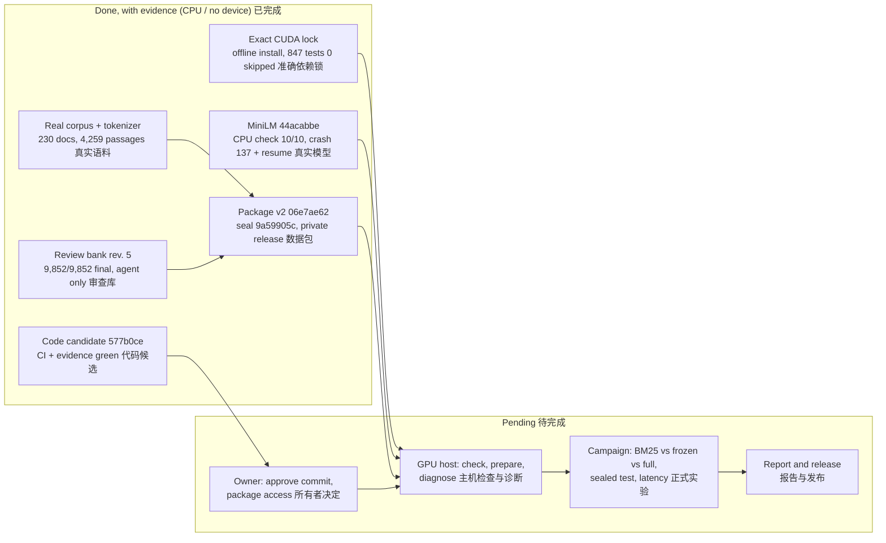
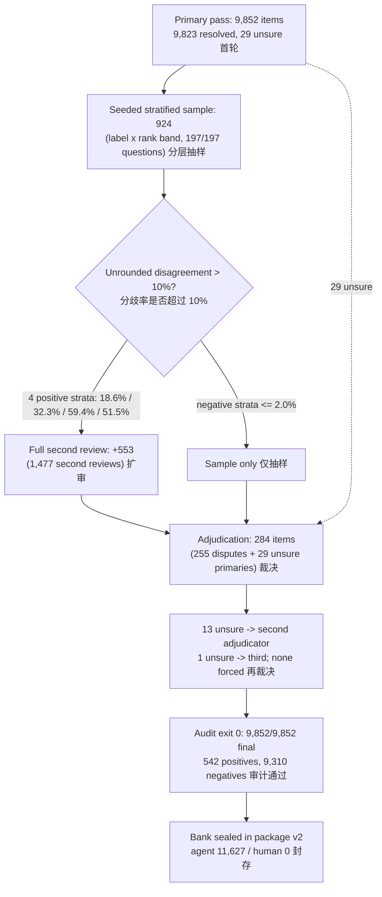
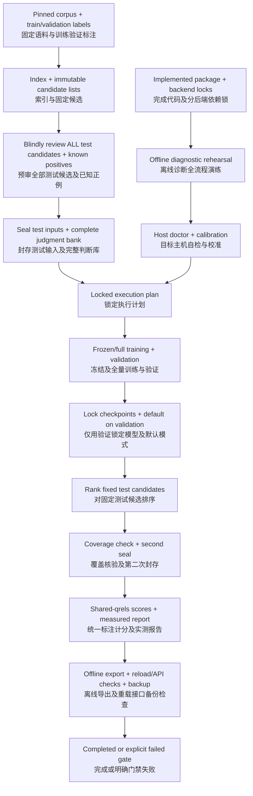
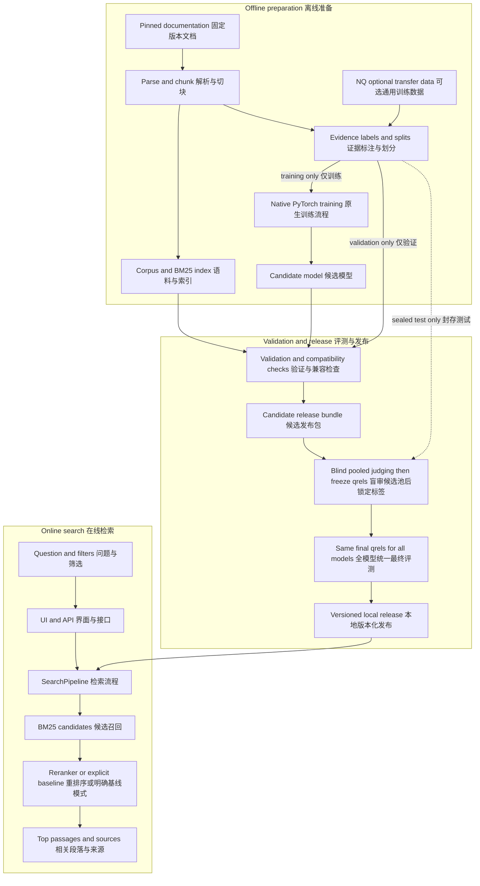
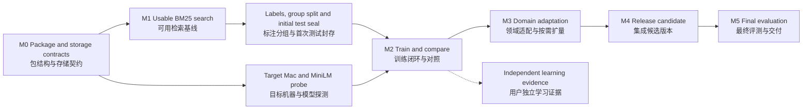

# Diagrams / 架构与流程图

Rendered copies of every diagram in `docs/*.mmd`, with their standing. The `.mmd` files are the sources; the two marked *current* were
added on 2026-10-08 and reflect [the evidence index](../reports/EVIDENCE_INDEX.md). The older diagrams are unchanged and describe the
design or the plan at the time they were drawn. In the copies below `\n` line breaks are written as ` ` so that GitHub renders them;
the wording is unchanged.

本页汇总 `docs/*.mmd` 全部图表并标注时效：两张“当前”图为 2026-10-08 新增；旧图保持原样，表示当时的设计或计划。

## 1. Current status / 当前状态 — current (`status-current.mmd`)

## 2. Review protocol as executed / 实际执行的审查流程 — current (`review-flow.mmd`)

Counts are from the final audit and the bank manifest (agent judgments only).

## 3. Accelerator run procedure / 加速器运行流程 — current design (`accelerator-run.mmd`)

The procedure `gpu.py` implements. Everything up to "Seal test inputs + complete judgment bank" has evidence; the host doctor and every
step after the locked plan are pending on the GPU host.

## 4. System architecture / 系统架构 — design (`architecture.mmd`)

Design revision 3. "NQ optional transfer data" was never used: the current data are the `pytorch/tutorials` corpus with synthetic,
agent-reviewed questions. The online path (UI, API, SearchPipeline, BM25, reranker or explicit baseline) is implemented and was exercised on
CPU with a diagnostic model only.

## 5. Roadmap / 路线图 — history (`roadmap.mmd`)

Drawn when the target was a Mac mini. Since then the target became a rented NVIDIA host (MPS stays optional); M0, M1 and the "labels, group split and initial test seal" step are done; the
on-device MiniLM probe, training and comparison (M2–M3), release (M4) and final evaluation (M5) are pending on the GPU host.

