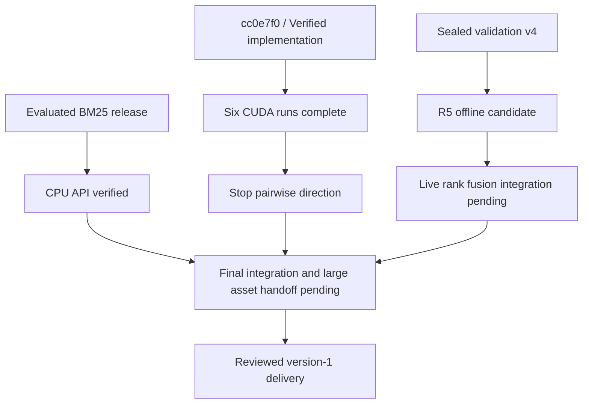
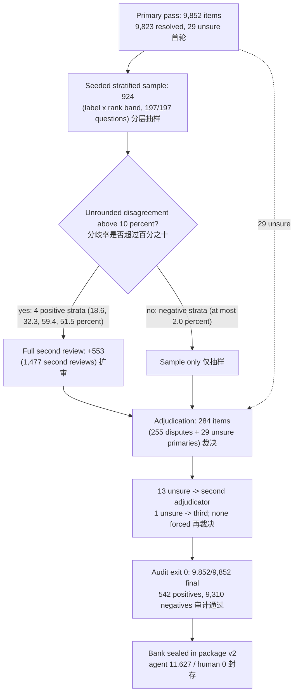
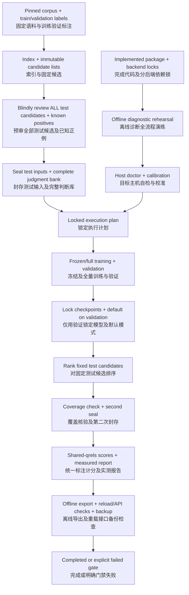
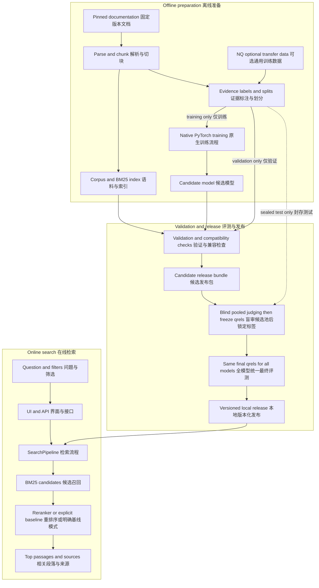
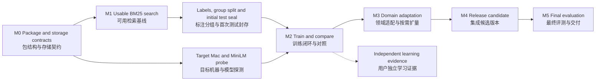

# Diagrams / 架构与流程图

> **2026-10-09:** the status diagram has been updated to completed training and pending product delivery. Other diagrams describe contracts; live R5 fusion is pending. [Current tasks](TASKS.md). / 状态图已更新为训练完成、产品交付待验；其他图为契约，R5 融合服务尚待接入。

Copies of every diagram in `docs/*.mmd`, with their standing. The `.mmd` files are the sources. The current status diagram was updated on 2026-10-09; the test-bank review diagram records the completed original review. Other diagrams describe contracts or historical plans. Copied diagrams use HTML line breaks for GitHub rendering.

本页汇总 `docs/*.mmd` 全部图表并标注时效：当前状态图更新于 2026-10-09；测试库审查图记录首轮已完成审查，其他图表示契约或历史计划。

## 1. Current status / 当前状态 — current (`status-current.mmd`)

## 2. Formal test-bank review as executed / 正式测试库审查流程 — historical execution (`review-flow.mmd`)

Counts are from the original formal test-bank audit and manifest (agent judgments only). They do not describe the later validation-v4 review; see [DATA_CARD](DATA_CARD.md) for that version.

数量来自首轮正式测试库的审计与清单，均为 Agent 判定；不代表后续验证 v4 的复审，后者见数据说明。

## 3. Accelerator run procedure / 加速器运行流程 — current design (`accelerator-run.mmd`)

The procedure `gpu.py` implements. The first formal campaign on `e3168ca` ran every step of it on an RTX 4090 (BM25 stays the default;
[evidence index §9](../reports/EVIDENCE_INDEX.md)).

## 4. System architecture / 系统架构 — design (`architecture.mmd`)

Design revision 3. "NQ optional transfer data" was never used: the current data are the `pytorch/tutorials` corpus with synthetic,
agent-reviewed questions. The online path (UI, API, SearchPipeline, BM25, reranker or explicit baseline) is implemented and was exercised on
CPU with a diagnostic model only.

## 5. Roadmap / 路线图 — history (`roadmap.mmd`)

Drawn when the target was a Mac mini. Since then the target became a rented NVIDIA host (MPS stays optional). M0–M2 and the first
comparison are done: the first formal campaign kept BM25 as the default. Domain adaptation (M3), a model release (M4) and further
evaluation (M5) have not been pursued; a second round is an exploratory experiment whose complete evidence is pending delivery.

