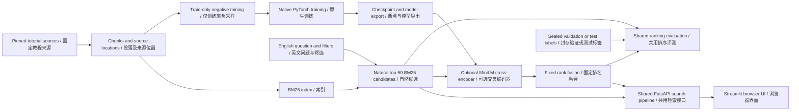

# Project guide / 项目导读

DevSearch is an English technical-document retrieval application and a native PyTorch training/evaluation project. Version `1.1.0` is a release candidate being prepared for public delivery. The evaluated default is BM25, with an optional frozen R5 seed 42 + rank-fusion candidate. [Current results](../reports/RESULTS.md) and [release tasks](TASKS.md) define the evidence and delivery scope.

DevSearch 是英文技术文档检索应用与原生 PyTorch 训练／评测项目。`1.1.0` 为正在准备公开交付的发布候选，已评测默认使用 BM25，并提供可选固定 R5 种子 42 加排名融合候选。当前证据与交付范围以[结果报告](../reports/RESULTS.md)和[发布任务](TASKS.md)为准。

**Main finding:** on the same sealed 202-question synthetic validation benchmark, R5 fused MRR@10 exceeds BM25 for each of seeds 42/43/44: **0.934076 / 0.944059 / 0.945050**, mean **0.941062** against **0.901416**. This is replication within an adaptively used validation benchmark. The historical 197-question test and separate 59-question holdout are reported independently; the latter failed the frozen R5 candidate's quality gates.

**主要结论：**在同一份封存的 202 题合成验证基准上，三个 R5 种子的融合 MRR@10 均超过 BM25，成绩及均值如上。这表示在反复用于开发的验证基准内复现；历史 197 题测试和独立 59 题留出集另行报告，后者未通过固定 R5 候选的效果门槛。

## Overall architecture / 整体架构



The UI calls one API; model scoring, rank fusion and fallback run in that shared pipeline. Training negatives belong to the training split. Sealed validation/test labels enter evaluation only. Public fixture execution and private full-corpus experiments have separate input requirements.

界面调用单个接口，评分、排名融合及降级在共用流程中执行；负例仅属于训练集，封存验证／测试标签只用于评测。公开样例与私有完整语料实验的输入要求分开说明。

## Reading routes / 阅读路线

- **Project review:** README → RESULTS → MODEL_CARD / DATA_CARD → EVIDENCE_INDEX.
  **项目审阅：**项目首页 → 实验结果 → 模型与数据说明 → 证据索引。
- **Development:** REPRODUCIBILITY → CODE_WALKTHROUGH → owning numbered specification → TASKS.
  **继续开发：**复现指南 → 代码导读 → 对应编号规格 → 当前任务。
- **Demonstration/interview:** DEMO_SCRIPT → INTERVIEW_GUIDE; practice explaining one training modification and one failed experiment.
  **演示与面试：**演示脚本 → 面试指南；独立解释一次训练修改和一次失败实验。

## File map / 目录职责

```text
devsearch/
├── README.md                 # project entry and verified result summary
├── pyproject.toml            # Python package and optional dependencies
├── LICENSE                   # Apache-2.0 for original DevSearch work
├── THIRD_PARTY_NOTICES.md     # retained upstream attribution and terms
├── src/devsearch/
│   ├── ingestion/            # pinned source parsing and chunking
│   ├── data/                 # split ownership, negative mining and review
│   ├── retrieval/            # BM25 candidates and deterministic ordering
│   ├── modeling/             # tokenizer, MiniLM and checkpoint/model I/O
│   ├── training/             # native PyTorch loops and recovery
│   ├── evaluation/           # metrics, selection, bootstrap and latency
│   ├── serving/              # shared pipeline, FastAPI and Streamlit
│   └── execution/            # bounded campaigns and artifact gates
├── configs/                  # reviewed experiment and serving configurations
├── locks/                    # hashed, backend-specific dependencies
├── scripts/                  # operator entry points and evidence checks
├── tests/                    # unit/integration checks and small fixtures
├── docs/                     # operation, model/data cards and contracts
└── reports/
    ├── RESULTS.md            # current outcome and limits
    ├── EVIDENCE_INDEX.md     # provenance and historical records
    └── evidence/             # compact, sanitized evidence
```

Keep implementation paths stable: scripts, package imports and frozen evidence already depend on them. Organize the reader-facing entry points instead of moving source files into a cosmetic new layout.

保留实现路径稳定：脚本、包导入和冻结证据已经依赖这些路径。通过统一阅读入口完成整理，不为外观移动源码目录。

| File / 文件 | Responsibility / 职责 |
| --- | --- |
| [HANDOFF](HANDOFF.md) | Current technical state and next action / 当前技术状态与下一步 |
| [TASKS](TASKS.md) | Concrete completion evidence and remaining release gates / 已完成证据与剩余发布验收 |
| [REPRODUCIBILITY](REPRODUCIBILITY.md) | Small runnable example, CI checks and full artifact requirements / 小型可运行示例、CI 与完整产物要求 |
| [MODEL_CARD](MODEL_CARD.md) | Candidate identities, uses and limits / 模型标识、用途和限制 |
| [DATA_CARD](DATA_CARD.md) | Dataset origin, splits and label provenance / 数据来源、划分和标签来源 |
| [RESULTS](../reports/RESULTS.md) | One authoritative result summary / 统一结果摘要 |
| [DEMO_SCRIPT](DEMO_SCRIPT.md) | Verified BM25 release and separate real R5 candidate API/UI demonstrations / 已核验 BM25 发布包与独立真实 R5 候选接口／界面演示 |

## Runtime storage / 运行数据存储

A private `DEVSEARCH_RUNTIME_ROOT` holds corpus snapshots, indexes, review state, model assets, environments and checkpoints. The Git repository contains manifests/configuration, small fixtures and sanitized result summaries. Selected R5 inference assets and current CPU evidence are restored and hash-verified on owner-approved external storage. Native training checkpoints remain on the server; all-checkpoint backup is not complete. The small committed evidence does not reproduce private judgments or restore model weights on its own.

私有 `DEVSEARCH_RUNTIME_ROOT` 保存语料快照、索引、审查状态、模型资产、环境和断点。Git 保存清单／配置、小样例及脱敏结果摘要。选定 R5 推理资产及当前 CPU 证据已在获认可的外置盘恢复并核验；原训练断点保留服务器，全部断点备份未完成。已提交的小型证据本身不能复现私有判定或恢复权重。

The R5 extension has working fixed-fusion CPU API/UI and a completed 59-question independent evaluation. Its two quality gates failed, so it remains an experimental candidate requiring `--allow-candidate`; the `1.1.0` release candidate retains BM25 as default. The family mean `0.941062` is the three-seed validation result, whereas the application uses seed 42, validation MRR `0.934076`. [Independent report](../reports/r5-independent-holdout-2026-10-10.md) · [inference reproduction](R5_INTEGRATION.md).

R5 扩展已完成固定融合 CPU 接口／界面与 59 题独立评测。两个效果门槛未通过，继续作为须显式允许的实验候选；`1.1.0` 发布候选保持 BM25 默认。系列均值 `0.941062` 属于三种子验证结果，应用使用种子 42，其验证 MRR 为 `0.934076`。范围见独立报告与推理复现说明。

Original DevSearch code is licensed under [Apache-2.0](../LICENSE). Third-party documentation, dependencies and pretrained assets retain their own terms in [THIRD_PARTY_NOTICES](../THIRD_PARTY_NOTICES.md). A public clone runs the small committed example; full private-label experiments require owner-held inputs and model assets.

DevSearch 原创代码采用 [Apache-2.0](../LICENSE)，第三方文档、依赖及预训练资产继续遵循[各自条款](../THIRD_PARTY_NOTICES.md)。公开克隆可运行仓库内小样例；完整私有标签实验需所有者持有的输入及模型资产。

## Contracts and history / 契约与历史

Numbered documents remain authoritative for their technical topic: [02 data](02-data-and-evaluation.md), [03 training](03-implementation.md), [04 serving](04-integration-and-decisions.md), [10 execution](10-accelerator-execution-contract.md), and [16 grouped comparison](16-grouped-loss-experiment.md). Their dated readiness paragraphs describe the date written; [HANDOFF](HANDOFF.md) supersedes those status paragraphs only.

编号文档继续管理对应技术契约：数据、训练、服务、执行及分组对照。内部带日期的就绪段落描述当时状态；[当前交接](HANDOFF.md)仅替代这些状态段落，不改写契约。

Claude's organization work is preserved in Git history at [`afcba198`](https://github.com/Hector-sau/devsearch/tree/afcba198433991d504a9c8ebc3d886d6b0585420). The [first-campaign draft](../reports/experiment-report-draft.md), original receipts and older code permalinks remain historical evidence. This update incorporates code base `cc0e7f0`, later experiments and the completed validation-label release; it does not rerun or relabel historical experiments.

Claude 的整理稿保留在上述 Git 提交中。首轮报告草稿、原回执及旧代码永久链接继续作为历史证据。本次整理纳入 `cc0e7f0` 代码基线、后续实验与已完成的验证标签发布，不重新运行或改标历史实验。
